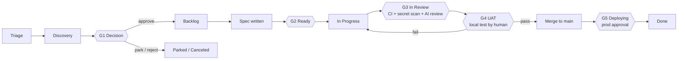

# Human-Agent Agile Methodology (HAAM)

*From idea to production, with humans deciding and agents executing.*

HAAM is the operating model for how humans and coding agents (Claude Code, Cursor, Codex, Grok or any other) build this product together.
It is the single source of truth for **stages, streams, statuses, gates and who may do what**.
`AGENTS.md` summarises it for agents; if they ever disagree, this file wins and `AGENTS.md` must be fixed.

---

## 1. Principles

1. **Everything lives in Git or the tracker.** Nothing important exists only in a chat, a Claude memory or someone's head. Any person with their own Claude account can clone the repo, connect the tracker and pick up where anyone else left off.
2. **The tracker is where work is planned and tracked. Git is where knowledge and code live.** The tracker is a GitHub Projects board or Linear, chosen per project (`docs/process/TRACKER.md`). Ticket = intent and status. Repo = specs, decisions, architecture, UAT plans, code.
3. **Humans decide, agents execute.** Agents can propose, assess, spec, build, test and prepare UAT. Only humans approve ideas, approve specs, pass UAT, merge to `main` and approve production deploys.
4. **Gates are cheap to pass and expensive to skip.** Every gate can be overridden by a human, but every override leaves a trail and a follow-up ticket.
5. **Small slices.** One ticket → one branch → one PR, reviewable in ~15 minutes. Anything bigger is split before it reaches `Ready`.

---

## 2. The three work streams

Agents pull work from three streams. They look the same in the tracker (issues) but are distinguished by label and follow slightly different paths.

| Stream | Label | Starts in | Typical source | Path |
|---|---|---|---|---|
| **Ideas** | `stream:idea` | Triage | Anyone: you, a customer, an agent noticing something | Full lifecycle (all gates) |
| **Features** | `stream:feature` | Backlog | Approved ideas, roadmap items | Spec → build → UAT → deploy |
| **Issues (bugs)** | `stream:bug` | Triage | Users, monitoring, UAT failures | Short path: repro → fix → UAT verify → deploy |

When an idea is approved at Gate G1 its label changes from `stream:idea` to `stream:feature`. It keeps the same issue ID so the whole history stays in one place.

### Epics
An **epic** is a parent issue (label `epic`) that groups the issues making up one feature, with a brief in `docs/epics/` holding the context: who it's for, the outcome, scope, slices and order. It goes through Triage, Discovery and Decision like an idea, so G1 is decided once for the whole feature (`/decide` applies to its idea sub-issues too). After that, each sub-issue is specced, passes G2 and is built on its own; the epic itself is never built. The epic moves to In Progress when its first sub-issue is claimed and is closed when the last one is released. Grouping and shaping are done with the product owner: `/triage group` and `/epic` (`docs/process/PRODUCT-MANAGER.md` §4).

---

## 3. Stages and statuses

| # | Status | Linear category (Linear only) | Meaning | Who moves it here |
|---|---|---|---|---|
| 1 | **Triage** | Triage | New idea or bug, unassessed | Anyone (`/idea`, `/bug`) |
| 2 | **Discovery** | Backlog | Being assessed: value, effort, risk, feasibility spike | Agent (`/assess`) |
| 3 | **Decision** | Backlog | Assessment done, waiting for a human call (**G1**) | Agent, after `/assess` |
| 4 | **Backlog** | Backlog | Approved, prioritised, needs a spec | Human (`/decide approve`) |
| 5 | **Ready** | Unstarted | Spec approved, Definition of Ready met (**G2**), label `agent-ready` | Human approves spec |
| 6 | **In Progress** | Started | An agent or developer has claimed it and is building | Agent (`/build`) |
| 7 | **In Review** | Started | PR ready for review, CI running, code review (**G3**) | Tracker automation when the PR is marked ready (Linear integration / `tracker-sync` workflow); drafts stay In Progress |
| 8 | **UAT** | Started | CI green, UAT plan ready, waiting for a human to test locally (**G4**) | Agent, when CI is green |
| 9 | **Deploying** | Started | Merged to `main`, production deploy waiting for approval (**G5**) | Tracker automation on PR merge |
| 10 | **Done** | Completed | Live in production and verified | Human (`/release`) |
| – | **Parked** | Canceled | Good idea, not now. Revisited at backlog review | Human |
| – | **Canceled** | Canceled | Will not do | Human |

**Test-first order (the default, `"flow": "test-first"`):** the owner tests before any PR exists, so after In Progress the issue goes to **UAT** (G4, on the agent's pushed branch), then, when they pass it, **In Review** (the PR opens and G3's checks and reviews run once, on the tested commit), then Deploying and Done. A failed test, or a failed check, sends it back to Ready with `uat-failed`; changed code is always tested again. Projects that prefer the checks first (`"flow": "checks-first"`) use the order in the table.

Bugs skip Discovery and Decision: **Triage → Ready → In Progress → In Review → UAT → Deploying → Done**. An agent may move a bug from Triage to Ready only when it has written reproduction steps and a confirmed root cause hypothesis; a human still owns the priority.

---

## 4. Stage-by-stage

### Stage 1: Idea capture (Triage)
- **Input:** a sentence, a voice note, a customer email.
- **Skill:** `/idea <description>`.
- **Output:** an issue in the tracker with label `stream:idea`, status Triage, filled from `docs/templates/idea.md` (problem, who it's for, why now, rough success signal).
- **Rule:** capture is fast and cheap. No judgement yet.

### Stage 2: Assessment and feasibility (Discovery)
- **Skill:** `/assess APP-123`.
- **The agent produces** `docs/assessments/APP-123-<slug>.md` from `docs/templates/assessment.md`:
  - Value: who benefits, how much, evidence.
  - Effort: T-shirt size (XS/S/M/L/XL) with reasoning from the actual codebase.
  - Risk: security, data protection, regulatory, operational.
  - Technical feasibility: which parts of the codebase change, unknowns, and **an optional spike** on a throwaway branch `spike/app-123-<slug>` that is **never merged**.
  - Options: at least two ways to do it, plus "do nothing".
  - Recommendation: approve / park / reject, with priority suggestion.
- The assessment is committed (via a small PR or directly on a `docs/` branch, see §8) and linked from the issue. Status moves to **Decision**.

### Stage 3: Decision (Gate G1, human)
- **Skill:** `/decide APP-123 approve|park|reject [priority] [notes]` (human-invoked only).
- Approve → status **Backlog**, label `stream:idea` replaced by `stream:feature`, priority set.
- Park → **Parked** with a "revisit when" note. Reject → **Canceled** with a reason.
- If the decision involves a technical choice that future agents must respect, an ADR is written in `docs/decisions/`.

### Stage 4: Specification (Backlog → Ready, Gate G2)
- **Skill:** `/spec APP-123`.
- The agent writes `docs/specs/APP-123-<slug>.md` from `docs/templates/feature-spec.md`: user stories, acceptance criteria in Given/When/Then, scope and out-of-scope, files likely touched, data/migration impact, test plan (unit + UAT), rollout and rollback.
- If the work is bigger than ~1 day of agent work or ~400 changed lines, the agent **splits it** into sub-issues, each with its own spec section.
- The spec is committed on the issue's own branch (no PR) and linked on the issue. When the human approves ("spec approved" in chat or as an issue comment), the agent or human adds label `agent-ready` and moves the issue to **Ready**. The spec then ships with the code in one PR. (A spec split into an epic's sub-issues gets a docs PR, so every slice can read it from `main`.)
- **Definition of Ready** is in `docs/process/GATES.md`.

### Stage 5: Build (In Progress)
- **Skill:** `/build APP-123` or `/next` (agent picks the top item).
- Claim protocol (see §7), then: branch from `main` using the issue's branch name (`123-short-title` on GitHub, Linear's branch name on Linear), implement against acceptance criteria, **write unit tests for every acceptance criterion**, run `make check` locally until green, update docs touched by the change, open a PR whose title starts with the issue ID.

### Stage 6: Automated verification and code review (In Review, Gate G3)
- **Deterministic checks** on every PR: `ci` (lint, types, unit tests, build), `secrets` (gitleaks over every commit), `dependencies` (vulnerability audit).
- **Independent reviewer agent**: a separate Claude running in GitHub Actions, which never saw the code being written, reviews the diff against the spec and `AGENTS.md` (`ai-review`), and Anthropic's security review checks for vulnerabilities (`security-review`). They post comments and can block; they can't approve or merge.
- The building agent fixes blocking findings (max two rounds, then hands over to a human). Only a human can overrule an AI review (label `ai-review-overruled`).
- **Human review** is mandatory for protected areas (`human-review` label).
- Full detail: `docs/process/GATES.md` § How code review works.

### Stage 7: User acceptance testing (UAT, Gate G4, human)
- **Skill:** `/uat APP-123` (agent prepares), then the human types `/test` (or records a result with `/uat-result APP-123 pass|fail`).
- When CI is green the agent writes `docs/uat/APP-123-<slug>.md` from `docs/templates/uat-plan.md`: how to run locally (`make dev` on the PR branch), test data, numbered steps with expected results and checkboxes, edge cases, what is out of scope.
- The agent posts a short version on the issue and moves it to **UAT**. The human is notified by the tracker.
- Human tests on **local** first: `/test` sets the change up and walks them through the plan. Pass → the PR gets the label `uat-passed`. Fail → the failures are recorded as a checklist on the issue, which gets the label `uat-failed` and goes back to **Ready**; agents fix `uat-failed` items before anything else, and the fix comes back to UAT.

### Stage 8: Release (Deploying → Done, Gate G5, human)
- After a pass, `/test` asks the human *"Ship it?"*. On `ship`, the agent (`haam.py ship <ID> --human`) merges the PR (the tracker moves the issue to **Deploying**), approves the waiting `production` deploy on the human's behalf, waits for it, runs the smoke check if defined, and closes the issue as **Done**. The human can also do each step by hand: merge, approve the deploy in GitHub, then `/release APP-123`.
- The release note (`docs/changes/<FILE-ID>.md`, one file per change) is added on the PR branch by `/uat`, so it ships with the change.

---

## 5. Roles

| Role | Who | Can do |
|---|---|---|
| **Product owner** | The person accountable for product decisions (one per product) | Everything. Owns G1, G2 approval, G4, G5, overrides, priorities |
| **Developer** | Any human contributor with their own Claude account | Capture, assess, spec, build, review, run UAT if delegated by the product owner; merge with the product owner's OK |
| **Agent** | Any coding-agent session in this repo, whatever the tool | Capture, assess, spike, spec, build, test, open PRs, prepare UAT, update tracker statuses up to **UAT**. **Never**: decide G1, approve specs, set `uat-passed`, merge to `main`, deploy, apply `gate-override` or `ai-review-overruled`, review their own PRs |

---

## 6. Priorities

The tracker's priority (Linear's built-in priority, or the board's Priority field on GitHub Projects) is the only priority source.

| Priority | Meaning | Expected handling |
|---|---|---|
| Urgent | Production broken or a legal/compliance deadline at risk | Drop everything. Override allowed |
| High | Important for current goals | Next up |
| Medium | Normal | In order |
| Low | Nice to have | When idle |
| No priority | Not yet triaged | Agents don't build these |

Order inside the same priority: bugs before features, older before newer, smaller before larger.

How to triage and choose priorities (levels, bug impact × reach, value/confidence/size, healthy queue sizes): `docs/process/PRODUCT-MANAGER.md`. The product owner can do it with an agent (`/triage`) or directly in the tracker.

---

## 7. Working in parallel (multiple humans, multiple agents)

1. **Claiming is done in the tracker, not in chat.** Before building, an agent re-reads the issue. If it is already *In Progress* or assigned to someone else, it skips it. Otherwise it assigns it to the human running the session, sets *In Progress* and posts a comment: `🤖 Claimed by <name> via <tool> [on <machine>] · branch <branch>`.
2. **One issue per session, one folder per chat.** A session works on one issue at a time. To run several agents at once on one machine, each chat gets its own git worktree so they don't share a working directory: start each agent chat with `/work` (see `docs/ONBOARDING.md`).
3. **Branch names come from the issue** (`123-short-title` on GitHub, `app-123-short-title` on Linear), so the link to the issue is automatic.
4. **Always rebase on fresh `main`** before opening or updating a PR.
5. **No personal state in shared files.** Personal preferences go in git-ignored files (`CLAUDE.local.md`, `AGENTS.local.md`, `.claude/settings.local.json`…).
6. **Handover note.** If a session stops before finishing, the agent posts a comment on the issue: done / not done / next step / gotchas, and pushes the branch as a draft PR. Anyone can resume from that.

---

## 8. Where each artefact lives

| Artefact | Location | Created by |
|---|---|---|
| Idea, bug, status, priority, discussion | Tracker issue | `/idea`, `/bug` |
| Assessment and feasibility | `docs/assessments/APP-123-*.md` | `/assess` |
| Spike code | branch `spike/app-123-*` (never merged) | `/assess` |
| Decision record (technical) | `docs/decisions/NNNN-*.md` (ADR) | `/decide`, `/spec` |
| Epic brief | `docs/epics/APP-123-*.md` | `/epic` |
| Feature spec | `docs/specs/APP-123-*.md` | `/spec` |
| Code + unit tests | `src/`, `tests/` (per stack) | `/build` |
| UAT plan | `docs/uat/APP-123-*.md` (results: comments on the issue and PR) | `/uat`, `/test` |
| Release notes | `docs/changes/<FILE-ID>.md` (one per change); `CHANGELOG.md` when you cut a version | `/uat` |
| Product context | `docs/product/PRODUCT.md` | Humans |
| Architecture map | `docs/product/ARCHITECTURE.md` | Agents keep it current |

Assessments and specs live on the issue's branch and ship with the code, so most issues need one PR, not three. Docs-only PRs (epic briefs, split specs) are cheap: CI and the AI reviews skip them, and the UAT gate doesn't apply.

---

## 9. Ceremonies (lightweight)

- **Daily triage (10–15 min, human):** test what's in *UAT*, empty *Triage* (`/triage`).
- **Weekly backlog review (30 min, human):** go through *Decision* (decide), *Parked* (revisit), *Backlog* (re-prioritise, `/triage backlog`), stuck work (`/triage stale`).
- The full rhythm and checklists for the product owner: `docs/process/PRODUCT-MANAGER.md`.
- **Daily, optional:** a scheduled Claude task posts a digest to you: what moved, what is blocked, what is waiting on you.
