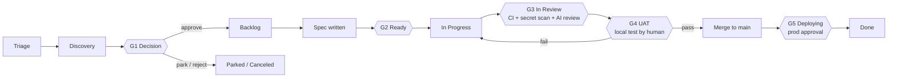

# Human-Agent Agile Methodology (HAAM)

*From idea to production, with humans deciding and agents executing.*

HAAM is the operating model for how humans and coding agents (Claude Code, Cursor, Codex, Grok or any other) build this product together.
It is the single source of truth for **stages, streams, statuses, gates and who may do what**.
`AGENTS.md` summarises it for agents; if they ever disagree, this file wins and `AGENTS.md` must be fixed.

---

## 1. Principles

1. **Everything lives in Git or Linear.** Nothing important exists only in a chat, a Claude memory or someone's head. Any person with their own Claude account can clone the repo, connect Linear and pick up where anyone else left off.
2. **Linear is where work is planned and tracked. Git is where knowledge and code live.** Ticket = intent and status. Repo = specs, decisions, architecture, UAT plans, code.
3. **Humans decide, agents execute.** Agents can propose, assess, spec, build, test and prepare UAT. Only humans approve ideas, approve specs, pass UAT, merge to `main` and approve production deploys.
4. **Gates are cheap to pass and expensive to skip.** Every gate can be overridden by a human, but every override leaves a trail and a follow-up ticket.
5. **Small slices.** One ticket → one branch → one PR, reviewable in ~15 minutes. Anything bigger is split before it reaches `Ready`.

---

## 2. The three work streams

Agents pull work from three streams. They look the same in Linear (issues) but are distinguished by label and follow slightly different paths.

| Stream | Linear label | Starts in | Typical source | Path |
|---|---|---|---|---|
| **Ideas** | `stream:idea` | Triage | Anyone: you, a customer, an agent noticing something | Full lifecycle (all gates) |
| **Features** | `stream:feature` | Backlog | Approved ideas, roadmap items | Spec → build → UAT → deploy |
| **Issues (bugs)** | `stream:bug` | Triage | Users, monitoring, UAT failures | Short path: repro → fix → UAT verify → deploy |

When an idea is approved at Gate G1 its label changes from `stream:idea` to `stream:feature`. It keeps the same Linear issue ID so the whole history stays in one place.

---

## 3. Stages and Linear statuses

| # | Linear status | Linear category | Meaning | Who moves it here |
|---|---|---|---|---|
| 1 | **Triage** | Triage | New idea or bug, unassessed | Anyone (`/idea`, `/bug`) |
| 2 | **Discovery** | Backlog | Being assessed: value, effort, risk, feasibility spike | Agent (`/assess`) |
| 3 | **Decision** | Backlog | Assessment done, waiting for a human call (**G1**) | Agent, after `/assess` |
| 4 | **Backlog** | Backlog | Approved, prioritised, needs a spec | Human (`/decide approve`) |
| 5 | **Ready** | Unstarted | Spec approved, Definition of Ready met (**G2**), label `agent-ready` | Human approves spec |
| 6 | **In Progress** | Started | An agent or developer has claimed it and is building | Agent (`/build`) |
| 7 | **In Review** | Started | PR open, CI running, code review (**G3**) | Linear GitHub automation on PR open |
| 8 | **UAT** | Started | CI green, UAT plan ready, waiting for a human to test locally (**G4**) | Agent, when CI is green |
| 9 | **Deploying** | Started | Merged to `main`, production deploy waiting for approval (**G5**) | Linear GitHub automation on PR merge |
| 10 | **Done** | Completed | Live in production and verified | Human (`/release`) |
| – | **Parked** | Canceled | Good idea, not now. Revisited at backlog review | Human |
| – | **Canceled** | Canceled | Will not do | Human |

Bugs skip Discovery and Decision: **Triage → Ready → In Progress → In Review → UAT → Deploying → Done**. An agent may move a bug from Triage to Ready only when it has written reproduction steps and a confirmed root cause hypothesis; a human still owns the priority.

---

## 4. Stage-by-stage

### Stage 1: Idea capture (Triage)
- **Input:** a sentence, a voice note, a customer email.
- **Skill:** `/idea <description>`.
- **Output:** Linear issue with label `stream:idea`, status Triage, filled from `docs/templates/idea.md` (problem, who it's for, why now, rough success signal).
- **Rule:** capture is fast and cheap. No judgement yet.

### Stage 2: Assessment and feasibility (Discovery)
- **Skill:** `/assess APP-123`.
- **The agent produces** `docs/assessments/APP-123-<slug>.md` from `docs/templates/assessment.md`:
  - Value: who benefits, how much, evidence.
  - Effort: T-shirt size (XS/S/M/L/XL) with reasoning from the actual codebase.
  - Risk: security, data protection, regulatory, operational.
  - Technical feasibility: which parts of the codebase change, unknowns, and **an optional spike** on a throwaway branch `spike/app-123-<slug>` that is **never merged**.
  - Options: at least two ways to do it, plus "do nothing".
  - Recommendation: approve / park / reject, with priority suggestion.
- The assessment is committed (via a small PR or directly on a `docs/` branch, see §8) and linked from the Linear issue. Status moves to **Decision**.

### Stage 3: Decision (Gate G1, human)
- **Skill:** `/decide APP-123 approve|park|reject [priority] [notes]` (human-invoked only).
- Approve → status **Backlog**, label `stream:idea` replaced by `stream:feature`, priority set.
- Park → **Parked** with a "revisit when" note. Reject → **Canceled** with a reason.
- If the decision involves a technical choice that future agents must respect, an ADR is written in `docs/decisions/`.

### Stage 4: Specification (Backlog → Ready, Gate G2)
- **Skill:** `/spec APP-123`.
- The agent writes `docs/specs/APP-123-<slug>.md` from `docs/templates/feature-spec.md`: user stories, acceptance criteria in Given/When/Then, scope and out-of-scope, files likely touched, data/migration impact, test plan (unit + UAT), rollout and rollback.
- If the work is bigger than ~1 day of agent work or ~400 changed lines, the agent **splits it** into sub-issues, each with its own spec section.
- Spec is opened as a **docs PR** for review. When the human approves (merges the docs PR or comments "spec approved"), the agent or human adds label `agent-ready` and moves the issue to **Ready**.
- **Definition of Ready** is in `docs/process/GATES.md`.

### Stage 5: Build (In Progress)
- **Skill:** `/build APP-123` or `/next` (agent picks the top item).
- Claim protocol (see §7), then: branch from `main` using Linear's branch name, implement against acceptance criteria, **write unit tests for every acceptance criterion**, run `make check` locally until green, update docs touched by the change, open a PR whose title starts with the issue ID.

### Stage 6: Automated verification and code review (In Review, Gate G3)
- **Deterministic checks** on every PR: `ci` (lint, types, unit tests, build), `secrets` (gitleaks over every commit), `dependencies` (vulnerability audit).
- **Independent reviewer agent**: a separate Claude running in GitHub Actions, which never saw the code being written, reviews the diff against the spec and `AGENTS.md` (`ai-review`), and Anthropic's security review checks for vulnerabilities (`security-review`). They post comments and can block; they can't approve or merge.
- The building agent fixes blocking findings (max two rounds, then hands over to a human). Only a human can overrule an AI review (label `ai-review-overruled`).
- **Human review** is mandatory for protected areas (`human-review` label).
- Full detail: `docs/process/GATES.md` § How code review works.

### Stage 7: User acceptance testing (UAT, Gate G4, human)
- **Skill:** `/uat APP-123` (agent prepares), `/uat-result APP-123 pass|fail` (human records).
- When CI is green the agent writes `docs/uat/APP-123-<slug>.md` from `docs/templates/uat-plan.md`: how to run locally (`make dev` on the PR branch), test data, numbered steps with expected results and checkboxes, edge cases, what is out of scope.
- The agent posts a short version in Linear and moves the issue to **UAT**. The human is notified via Linear.
- Human tests on **local** first. Pass → `/uat-result pass` adds the PR label `uat-passed`. Fail → `/uat-result fail <notes>` sends it back to **In Progress** with the failures recorded as a checklist on the issue.

### Stage 8: Release (Deploying → Done, Gate G5, human)
- Human merges the PR. Linear moves the issue to **Deploying**.
- The deploy workflow starts and waits on the GitHub `production` environment, which requires a human approval.
- After deploy, `/release APP-123` runs a smoke check (if defined), closes the issue as **Done**, and appends a line to `CHANGELOG.md`.

---

## 5. Roles

| Role | Who | Can do |
|---|---|---|
| **Product owner** | The person accountable for product decisions (one per product) | Everything. Owns G1, G2 approval, G4, G5, overrides, priorities |
| **Developer** | Any human contributor with their own Claude account | Capture, assess, spec, build, review, run UAT if delegated by the product owner; merge with the product owner's OK |
| **Agent** | Any coding-agent session in this repo, whatever the tool | Capture, assess, spike, spec, build, test, open PRs, prepare UAT, update Linear statuses up to **UAT**. **Never**: decide G1, approve specs, set `uat-passed`, merge to `main`, deploy, apply `gate-override` or `ai-review-overruled`, review their own PRs |

---

## 6. Priorities

Linear's built-in priority field is the only priority source.

| Linear priority | Meaning | Expected handling |
|---|---|---|
| Urgent | Production broken or a legal/compliance deadline at risk | Drop everything. Override allowed |
| High | Important for current goals | Next up |
| Medium | Normal | In order |
| Low | Nice to have | When idle |
| No priority | Not yet triaged | Agents don't build these |

Order inside the same priority: bugs before features, older before newer, smaller before larger.

---

## 7. Working in parallel (multiple humans, multiple agents)

1. **Claiming is done in Linear, not in chat.** Before building, an agent re-reads the issue. If it is already *In Progress* or assigned to someone else, it skips it. Otherwise it assigns it to the human running the session, sets *In Progress* and posts a comment: `🤖 Claimed by <name>'s Claude session · branch <branch>`.
2. **One issue per session.** A session works on one issue at a time. To run several agents at once on one machine, use a separate git worktree per session (`git worktree add`, see `docs/ONBOARDING.md`) so they don't share a working directory.
3. **Branch names come from Linear** (`app-123-short-title`), so the Linear ↔ GitHub link is automatic.
4. **Always rebase on fresh `main`** before opening or updating a PR.
5. **No personal state in shared files.** Personal preferences go in git-ignored files (`CLAUDE.local.md`, `AGENTS.local.md`, `.claude/settings.local.json`…).
6. **Handover note.** If a session stops before finishing, the agent posts a Linear comment: done / not done / next step / gotchas, and pushes the branch as a draft PR. Anyone can resume from that.

---

## 8. Where each artefact lives

| Artefact | Location | Created by |
|---|---|---|
| Idea, bug, status, priority, discussion | Linear issue | `/idea`, `/bug` |
| Assessment and feasibility | `docs/assessments/APP-123-*.md` | `/assess` |
| Spike code | branch `spike/app-123-*` (never merged) | `/assess` |
| Decision record (technical) | `docs/decisions/NNNN-*.md` (ADR) | `/decide`, `/spec` |
| Feature spec | `docs/specs/APP-123-*.md` | `/spec` |
| Code + unit tests | `src/`, `tests/` (per stack) | `/build` |
| UAT plan and results | `docs/uat/APP-123-*.md` | `/uat`, `/uat-result` |
| Release notes | `CHANGELOG.md` | `/release` |
| Product context | `docs/product/PRODUCT.md` | Humans |
| Architecture map | `docs/product/ARCHITECTURE.md` | Agents keep it current |

Docs-only changes (assessments, specs, UAT plans) go through a small PR like any other change; CI is fast for docs and the gate check ignores docs-only PRs.

---

## 9. Ceremonies (lightweight)

- **Weekly backlog review (30 min, human):** go through *Decision* (decide), *Parked* (revisit), *Backlog* (re-prioritise), *UAT* (anything waiting on you).
- **Daily, optional:** a scheduled Claude task posts a digest to you: what moved, what is blocked, what is waiting on you.
