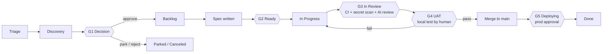

# Human-Agent Agile Methodology (HAAM)

*Von der Idee bis in die Produktion: Menschen entscheiden, Agenten führen aus.*

HAAM ist das Arbeitsmodell, nach dem Menschen und Coding-Agenten (Claude Code, Cursor, Codex, Grok oder jeder andere) dieses Produkt gemeinsam bauen.
Es ist die einzige verbindliche Quelle für **Phasen, Arbeitsstränge, Status, Gates und wer was darf**.
`AGENTS.md` fasst es für Agenten zusammen; wenn sich beide je widersprechen, gilt diese Datei und `AGENTS.md` muss korrigiert werden.

---

## 1. Prinzipien

1. **Alles liegt in Git oder im Tracker.** Nichts Wichtiges existiert nur in einem Chat, in einer Claude-Erinnerung oder im Kopf von jemandem. Jede Person mit eigenem Claude-Konto kann das Repo klonen, den Tracker verbinden und dort weitermachen, wo jemand anderes aufgehört hat.
2. **Im Tracker wird Arbeit geplant und verfolgt. In Git liegen Wissen und Code.** Der Tracker ist ein GitHub-Projects-Board oder Linear, gewählt pro Projekt (`docs/process/TRACKER.md`). Ticket = Absicht und Status. Repo = Specs, Entscheidungen, Architektur, UAT-Pläne, Code.
3. **Menschen entscheiden, Agenten führen aus.** Agenten können vorschlagen, bewerten, spezifizieren, bauen, testen und den UAT vorbereiten. Nur Menschen geben Ideen frei, geben Specs frei, lassen den UAT bestehen, mergen nach `main` und geben Produktions-Deploys frei.
4. **Gates sind billig zu bestehen und teuer zu überspringen.** Ein Mensch kann jedes Gate übergehen, aber jeder Override hinterlässt eine Spur und ein Folge-Ticket.
5. **Kleine Teilstücke.** Ein Ticket → ein Branch → ein PR, prüfbar in ~15 Minuten. Alles Größere wird aufgeteilt, bevor es `Ready` erreicht.

---

## 2. Die drei Arbeitsstränge

Agenten holen sich Arbeit aus drei Strängen. Im Tracker sehen sie gleich aus (Issues), werden aber per Label unterschieden und folgen leicht unterschiedlichen Wegen.

| Strang | Label | Beginnt in | Typische Quelle | Weg |
|---|---|---|---|---|
| **Ideen** | `stream:idea` | Triage | Jede Person: du, ein Kunde, ein Agent, dem etwas auffällt | Voller Lebenszyklus (alle Gates) |
| **Features** | `stream:feature` | Backlog | Freigegebene Ideen, Roadmap-Punkte | Spec → Build → UAT → Deploy |
| **Issues (Bugs)** | `stream:bug` | Triage | Nutzer, Monitoring, fehlgeschlagene UATs | Kurzer Weg: Reproduktion → Fix → Prüfung im UAT → Deploy |

Wird eine Idee an Gate G1 freigegeben, wechselt ihr Label von `stream:idea` zu `stream:feature`. Sie behält dieselbe Issue-ID, sodass die ganze Historie an einem Ort bleibt.

### Epics
Ein **Epic** ist ein übergeordnetes Issue (Label `epic`), das die Issues eines Features bündelt. Dazu gehört ein Brief in `docs/epics/` mit dem Kontext: für wen es ist, das Ergebnis, Umfang, Teilstücke und Reihenfolge. Es durchläuft Triage, Discovery und Decision wie eine Idee, sodass G1 einmal für das ganze Feature entschieden wird (`/decide` gilt auch für seine Ideen-Sub-Issues). Danach wird jedes Sub-Issue spezifiziert, besteht G2 und wird einzeln gebaut; das Epic selbst wird nie gebaut. Das Epic wechselt zu In Progress, wenn sein erstes Sub-Issue beansprucht wird, und wird geschlossen, wenn das letzte released ist. Bündeln und Formen geschieht zusammen mit dem Product Owner: `/triage group` und `/epic` (`docs/process/PRODUCT-MANAGER.md` §4).

---

## 3. Phasen und Status

| # | Status | Linear-Kategorie (nur Linear) | Bedeutung | Wer es hierher verschiebt |
|---|---|---|---|---|
| 1 | **Triage** | Triage | Neue Idee oder neuer Bug, noch nicht bewertet | Jede Person (`/idea`, `/bug`) |
| 2 | **Discovery** | Backlog | Wird bewertet (Wert, Aufwand, Risiko, Machbarkeits-Spike) oder als Wegwerf-Prototyp gebaut, den der Product Owner ausprobiert | Agent (`/assess`, oder `/spike`, wenn der Product Owner `prototype` gewählt hat) |
| 3 | **Decision** | Backlog | Bewertung oder Prototyp fertig, wartet auf eine menschliche Entscheidung (**G1**) | Agent, nach `/assess` oder `/spike` |
| 4 | **Backlog** | Backlog | Freigegeben, priorisiert, braucht eine Spec | Mensch (`/decide approve`) |
| 5 | **Ready** | Unstarted | Spec freigegeben, Definition of Ready erfüllt (**G2**), Label `agent-ready` | Mensch gibt die Spec frei |
| 6 | **In Progress** | Started | Ein Agent oder Developer hat es beansprucht und baut es | Agent (`/build`) |
| 7 | **In Review** | Started | PR bereit zum Review, CI läuft, Code-Review (**G3**) | Test-first: `publish`, wenn der Product Owner den Test bestehen lässt. Checks-first: Automatisierung des Trackers, sobald der PR als bereit markiert wird (Linear-Integration / Workflow `tracker-sync`); Drafts bleiben In Progress |
| 8 | **UAT** | Started | UAT-Plan fertig, wartet darauf, dass ein Mensch lokal testet (**G4**). Test-first: bevor der PR existiert; checks-first: sobald die CI grün ist | Agent (`/uat`) |
| 9 | **Deploying** | Started | Nach `main` gemergt, Produktions-Deploy wartet auf Freigabe (**G5**) | Automatisierung des Trackers beim Merge des PR |
| 10 | **Done** | Completed | Live in Produktion und geprüft | Mensch (`/release`) |
| – | **Parked** | Canceled | Gute Idee, aber nicht jetzt. Wird beim Backlog-Review wieder angeschaut | Mensch |
| – | **Canceled** | Canceled | Wird nicht gemacht | Mensch |

**Reihenfolge test-first (Standard, `"flow": "test-first"`):** Der Product Owner testet, bevor es einen PR gibt. Nach In Progress geht das Issue also zu **UAT** (G4, auf dem gepushten Branch des Agenten), dann, wenn der Test bestanden ist, zu **In Review** (der PR wird geöffnet, und die Checks und Reviews von G3 laufen einmal, auf dem getesteten Commit), dann zu Deploying und Done. Ein fehlgeschlagener Test oder Check schickt es mit `uat-failed` zurück nach Ready; geänderter Code wird immer erneut getestet. Projekte, die die Checks lieber zuerst haben (`"flow": "checks-first"`), nutzen die Reihenfolge aus der Tabelle. So oder so gehört ein bestandener Test zu dem Commit, der getestet wurde: Ein späterer Push entfernt `uat-passed`.

**Spur ohne UAT (`uat:skip`):** Für Änderungen, die der Product Owner nicht sinnvoll testen kann (ein Update des Kits oder der Konfiguration, ein Update einer Abhängigkeit, ein unsichtbares Refactoring, CI), markiert er das Issue mit `uat:skip`, wenn er es triagiert oder seine Spec freigibt. Der Agent überspringt dann den UAT: Der PR wird sofort geöffnet, CI und beide KI-Reviews laufen, das Gate ist bestanden, weil der Product Owner das Issue markiert hat, und auf GitHub Projects wird der PR von selbst gemergt (Auto-Merge; auf Linear liefert der Product Owner ihn aus). Das Issue geht In Progress → In Review → Deploying und mit dem nächsten `ship` des Product Owners, egal wofür, zu Done: Der Produktions-Deploy braucht weiterhin seine Freigabe, und ein Deploy enthält jede Änderung, die vor ihm gemergt wurde. Nie für geschützte Bereiche (`human-review`). (Auf Linear kann dessen GitHub-Integration das Issue schon beim Merge auf Done setzen, vor dem Deploy.)

**Prototypen und Epic-Build-Modus:** zwei Wege, Agenten große Teile schnell bauen zu lassen, ohne die Gates zu lockern (`docs/setup/DECISIONS.md` §8).
- **Erst ein Prototyp** (`/spike`): Ein Agent baut eine funktionierende Wegwerf-Version auf einem Branch `spike/`, vor der Entscheidung oder der Spec. Der Product Owner probiert sie aus und sagt `discard`, `change`, `rebuild` oder `keep`. Ein Spike wird nie gemergt. Was behalten wird, durchläuft `/spec` und die normalen Gates.
- **Epic-Build-Modus** (Label `mode:epic-build`): Ein leitender Agent baut jedes Teilstück eines freigegebenen Epics auf einem Branch, mit einem Checkpoint nach jedem Teilstück. Der Product Owner testet das ganze Feature einmal und liefert es einmal aus.

**Ausliefern in Paketen:** `/test all` testet alles Wartende in einer Sitzung, und `ship --all` mergt, was bestanden hat, plus das, was die Spur ohne UAT gemergt hat, und gibt dann **einen** Produktions-Deploy für alles frei (ältere wartende Deploy-Läufe werden abgebrochen: Der neueste enthält jede Änderung).

Bugs überspringen Discovery und Decision: **Triage → Ready → In Progress → UAT → In Review → Deploying → Done** (checks-first: In Review vor UAT). Ein Agent darf einen Bug nur dann von Triage nach Ready verschieben, wenn er Schritte zur Reproduktion und eine bestätigte Hypothese zur Ursache geschrieben hat; die Priorität bleibt Sache eines Menschen.

---

## 4. Phase für Phase

### Phase 1: Idee erfassen (Triage)
- **Input:** ein Satz, eine Sprachnachricht, eine E-Mail von einem Kunden.
- **Skill:** `/idea <description>`.
- **Ergebnis:** ein Issue im Tracker mit Label `stream:idea`, Status Triage, ausgefüllt nach `docs/templates/idea.md` (Problem, für wen, warum jetzt, grobes Erfolgssignal).
- **Regel:** Erfassen geht schnell und kostet wenig. Noch keine Bewertung.

### Phase 2: Bewertung und Machbarkeit (Discovery)
- **Skill:** `/assess APP-123`.
- **Der Agent erstellt** `docs/assessments/APP-123-<slug>.md` aus `docs/templates/assessment.md`:
  - Wert: wer profitiert, wie sehr, Belege.
  - Aufwand: T-Shirt-Größe (XS/S/M/L/XL) mit Begründung aus der echten Codebasis.
  - Risiko: Sicherheit, Datenschutz, Regulierung, Betrieb.
  - Technische Machbarkeit: welche Teile der Codebasis sich ändern, Unbekannte und **ein optionaler Spike** auf einem Wegwerf-Branch `spike/app-123-<slug>`, der **nie gemergt wird**.
  - Optionen: mindestens zwei Wege, es umzusetzen, plus „nichts tun“.
  - Empfehlung: freigeben / parken / ablehnen, mit einem Vorschlag zur Priorität.
- Die Bewertung wird committet (über einen kleinen PR oder direkt auf einem Branch `docs/`, siehe §8) und im Issue verlinkt. Der Status wechselt zu **Decision**.

### Phase 3: Entscheidung (Gate G1, Mensch)
- **Skill:** `/decide APP-123 approve|park|reject [priority] [notes]` (nur von Menschen aufgerufen).
- Freigeben → Status **Backlog**, Label `stream:idea` wird durch `stream:feature` ersetzt, Priorität gesetzt.
- Parken → **Parked** mit einer Notiz „wieder anschauen, wenn“. Ablehnen → **Canceled** mit einer Begründung.
- Enthält die Entscheidung eine technische Wahl, an die sich künftige Agenten halten müssen, wird ein ADR in `docs/decisions/` geschrieben.

### Phase 4: Spezifikation (Backlog → Ready, Gate G2)
- **Skill:** `/spec APP-123`.
- Der Agent schreibt `docs/specs/APP-123-<slug>.md` nach `docs/templates/feature-spec.md`: User Stories, Akzeptanzkriterien als Given/When/Then, Umfang und was nicht dazugehört, voraussichtlich betroffene Dateien, Auswirkungen auf Daten und Migrationen, Testplan (Unit + UAT), Rollout und Rollback.
- Ist die Arbeit größer als ~1 Tag Agentenarbeit oder ~400 geänderte Zeilen, **teilt der Agent sie** in Sub-Issues auf, jedes mit eigenem Abschnitt in der Spec.
- Die Spec wird auf dem eigenen Branch des Issues committet (ohne PR) und im Issue verlinkt. Wenn der Mensch sie freigibt („Spec freigegeben“ im Chat oder als Kommentar im Issue), fügt der Agent oder der Mensch das Label `agent-ready` hinzu und verschiebt das Issue nach **Ready**. Die Spec wird dann zusammen mit dem Code in einem PR ausgeliefert. (Eine Spec, die in Sub-Issues eines Epics aufgeteilt ist, bekommt einen Doku-PR, damit jedes Teilstück sie von `main` lesen kann.)
- Die **Definition of Ready** steht in `docs/process/GATES.md`.

### Phase 5: Bauen (In Progress)
- **Skill:** `/build APP-123` oder `/next` (der Agent nimmt den obersten Eintrag).
- Claim-Protokoll (siehe §7), dann: von `main` abzweigen, mit dem Branch-Namen des Issues (`123-short-title` auf GitHub, der Branch-Name von Linear auf Linear), gegen die Akzeptanzkriterien implementieren, **für jedes Akzeptanzkriterium Unit-Tests schreiben**, `make check` lokal ausführen, bis alles grün ist, die von der Änderung betroffene Doku aktualisieren, einen PR öffnen, dessen Titel mit der Issue-ID beginnt.

### Phase 6: Automatische Prüfung und Code-Review (In Review, Gate G3)
- **Deterministische Checks** bei jedem PR: `ci` (Lint, Typen, Unit-Tests, Build), `secrets` (gitleaks über jeden Commit), `dependencies` (Prüfung auf Schwachstellen).
- **Unabhängiger Reviewer-Agent**: Ein separates Claude, das in GitHub Actions läuft und nie gesehen hat, wie der Code geschrieben wurde, prüft den Diff gegen die Spec und `AGENTS.md` (`ai-review`). Ein reines Sicherheits-Review sucht nach Schwachstellen (`security-review`: das Security-Review von Anthropic mit einem API-Schlüssel oder eine Claude-Sitzung nach `.github/review/SECURITY-REVIEWER.md` mit einem Token aus einem Claude-Plan). Jedes der beiden Secrets startet beide Reviews, und ihre Anweisungen kommen von `main`. Sie schreiben Kommentare und können blockieren; freigeben oder mergen können sie nicht.
- Der bauende Agent behebt blockierende Befunde (höchstens zwei Runden, dann übergibt er an einen Menschen). Nur ein Mensch kann ein KI-Review überstimmen (Label `ai-review-overruled`).
- **Menschliches Review** ist für geschützte Bereiche Pflicht (Label `human-review`).
- Alle Details: `docs/process/GATES.md` § So funktioniert das Code-Review.

### Phase 7: Abnahmetest (UAT, Gate G4, Mensch)
- **Skill:** `/uat APP-123` (der Agent bereitet vor), dann tippt der Mensch `/test` (oder hält ein Ergebnis mit `/uat-result APP-123 pass|fail` fest).
- Der Agent schreibt `docs/uat/APP-123-<slug>.md` nach `docs/templates/uat-plan.md` (test-first: wenn `make check` auf seinem gepushten Branch durchläuft; checks-first: wenn die CI auf dem PR grün ist): wie man lokal startet (`make dev` auf dem Branch), Testdaten, nummerierte Schritte mit erwarteten Ergebnissen und Checkboxen, Grenzfälle, was nicht dazugehört.
- Der Agent postet eine Kurzfassung im Issue und verschiebt es nach **UAT**. Der Tracker benachrichtigt den Menschen.
- Der Mensch testet zuerst **lokal**: `/test` richtet die Änderung ein und führt durch den Plan. Bestanden → test-first: Der PR wird mit dem Label `uat-passed` geöffnet, und die Checks laufen einmal, auf dem getesteten Commit; checks-first: Der PR bekommt das Label `uat-passed`. Ein späterer Push entfernt das Label, sodass geänderter Code erneut getestet wird. Nicht bestanden → Die Fehler werden als Checkliste im Issue festgehalten, das das Label `uat-failed` bekommt und zurück nach **Ready** geht; Agenten beheben `uat-failed`-Einträge vor allem anderen, und der Fix kommt zurück in den UAT.

### Phase 8: Release (Deploying → Done, Gate G5, Mensch)
- Nach einem bestandenen Test fragt `/test` den Menschen *„Ausliefern?“*. Auf `ship` hin mergt der Agent (`haam.py ship <ID> --human`) den PR (der Tracker verschiebt das Issue nach **Deploying**), gibt den wartenden Deploy auf `production` im Namen des Menschen frei, wartet darauf, führt den Smoke-Test aus, falls definiert, und schließt das Issue als **Done**. Der Mensch kann jeden Schritt auch von Hand erledigen: mergen, den Deploy in GitHub freigeben, dann `/release APP-123`.
- Die Release Note (`docs/changes/<FILE-ID>.md`, eine Datei pro Änderung) wird von `/uat` auf dem Branch des PR hinzugefügt, sodass sie mit der Änderung ausgeliefert wird.

---

## 5. Rollen

| Rolle | Wer | Darf |
|---|---|---|
| **Product Owner** | Die Person, die für Produktentscheidungen verantwortlich ist (eine pro Produkt) | Alles. Verantwortet G1, die Freigabe an G2, G4, G5, Overrides, Prioritäten |
| **Developer** | Jede mitwirkende Person mit eigenem Claude-Konto | Erfassen, bewerten, spezifizieren, bauen, reviewen, den UAT durchführen, wenn der Product Owner das überträgt; mergen mit dem OK des Product Owners |
| **Agent** | Jede Coding-Agent-Sitzung in diesem Repo, egal mit welchem Tool | Erfassen, bewerten, Spikes bauen, spezifizieren, bauen, testen, PRs öffnen, den UAT vorbereiten, Status im Tracker bis **UAT** aktualisieren. **Nie**: über G1 entscheiden, Specs freigeben, `uat-passed` setzen, nach `main` mergen, deployen, `gate-override` oder `ai-review-overruled` setzen, eigene PRs reviewen |

---

## 6. Prioritäten

Die Priorität im Tracker (die eingebaute Priorität von Linear oder das Feld Priority des Boards auf GitHub Projects) ist die einzige Quelle für Prioritäten.

| Priorität | Bedeutung | Erwarteter Umgang |
|---|---|---|
| Urgent | Produktion kaputt oder eine rechtliche oder Compliance-Frist in Gefahr | Alles liegen lassen. Override erlaubt |
| High | Wichtig für die aktuellen Ziele | Als Nächstes |
| Medium | Normal | Der Reihe nach |
| Low | Wäre schön | Wenn sonst nichts ansteht |
| No priority | Noch nicht triagiert | Agenten bauen so etwas nicht |

Reihenfolge innerhalb derselben Priorität: Bugs vor Features, ältere vor neueren, kleinere vor größeren.

Wie du triagierst und Prioritäten wählst (Stufen, Auswirkung × Reichweite bei Bugs, Wert/Sicherheit/Größe, gesunde Warteschlangengrößen): `docs/process/PRODUCT-MANAGER.md`. Der Product Owner kann das mit einem Agenten erledigen (`/triage`) oder direkt im Tracker.

---

## 7. Parallel arbeiten (mehrere Menschen, mehrere Agenten)

1. **Beansprucht wird im Tracker, nicht im Chat.** Vor dem Bauen liest ein Agent das Issue erneut. Ist es schon *In Progress* oder jemand anderem zugewiesen, überspringt er es. Sonst weist er es dem Menschen zu, der die Sitzung führt, setzt *In Progress* und postet einen Kommentar: ``🤖 Claimed by <name> via <tool> [on <machine>] · branch `<branch>` ``.
2. **Ein Issue pro Sitzung, ein Ordner pro Chat.** Eine Sitzung arbeitet immer nur an einem Issue. Um mehrere Agenten gleichzeitig auf einer Maschine laufen zu lassen, bekommt jeder Chat seinen eigenen Git-Worktree, damit sie sich kein Arbeitsverzeichnis teilen: Starte jeden Agenten-Chat mit `/work` (siehe `docs/ONBOARDING.md`).
3. **Branch-Namen kommen vom Issue** (`123-short-title` auf GitHub, `app-123-short-title` auf Linear), so entsteht die Verknüpfung zum Issue automatisch.
4. **Immer auf frisches `main` rebasen**, bevor du einen PR öffnest oder aktualisierst.
5. **Kein persönlicher Zustand in gemeinsamen Dateien.** Persönliche Vorlieben gehören in Dateien, die Git ignoriert (`CLAUDE.local.md`, `AGENTS.local.md`, `.claude/settings.local.json`…).
6. **Übergabenotiz.** Hört eine Sitzung vor dem Ende auf, postet der Agent einen Kommentar im Issue: erledigt / nicht erledigt / nächster Schritt / Stolperfallen, und pusht den Branch (checks-first: als Draft-PR; test-first: ohne PR). Jede Person kann von dort aus weitermachen.

---

## 8. Wo welches Artefakt liegt

| Artefakt | Ort | Erstellt von |
|---|---|---|
| Idee, Bug, Status, Priorität, Diskussion | Issue im Tracker | `/idea`, `/bug` |
| Bewertung und Machbarkeit | `docs/assessments/APP-123-*.md` | `/assess` |
| Spike-Code | Branch `spike/app-123-*` (nie gemergt; vom Release-Gate abgelehnt) | `/assess`, `/spike` |
| Entscheidungsprotokoll (technisch) | `docs/decisions/NNNN-*.md` (ADR) | `/decide`, `/spec` |
| Epic-Brief | `docs/epics/APP-123-*.md` | `/epic` |
| Feature-Spec | `docs/specs/APP-123-*.md` | `/spec` |
| Code + Unit-Tests | `src/`, `tests/` (je nach Stack) | `/build` |
| UAT-Plan | `docs/uat/APP-123-*.md` (Ergebnisse: Kommentare im Issue und im PR) | `/uat`, `/test` |
| Release Notes | `docs/changes/<FILE-ID>.md` (eine pro Änderung); `CHANGELOG.md`, wenn du eine Version erstellst | `/uat` |
| Produktkontext | `docs/product/PRODUCT.md` | Menschen |
| Architekturkarte | `docs/product/ARCHITECTURE.md` | Agenten halten sie aktuell |

Bewertungen und Specs liegen auf dem Branch des Issues und werden mit dem Code ausgeliefert, sodass die meisten Issues einen PR brauchen, nicht drei. Reine Doku-PRs (Epic-Briefs, aufgeteilte Specs) sind günstig: CI und die KI-Reviews überspringen sie, und das UAT-Gate gilt nicht.

---

## 9. Zeremonien (schlank)

- **Tägliche Triage (10–15 Min., Mensch):** testen, was in *UAT* liegt, *Triage* leeren (`/triage`).
- **Wöchentliches Backlog-Review (30 Min., Mensch):** *Decision* durchgehen (entscheiden), *Parked* (wieder anschauen), *Backlog* (neu priorisieren, `/triage backlog`), festhängende Arbeit (`/triage stale`).
- Den vollen Rhythmus und die Checklisten für den Product Owner findest du in `docs/process/PRODUCT-MANAGER.md`.
- **Täglich, optional:** Eine geplante Claude-Aufgabe schickt dir eine Zusammenfassung: was sich bewegt hat, was blockiert ist, was auf dich wartet.
