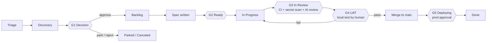

# Human-Agent Agile Methodology (HAAM)

*De la idea a producción, con las personas decidiendo y los agentes ejecutando.*

HAAM es el modelo de trabajo con el que las personas y los agentes de programación (Claude Code, Cursor, Codex, Grok o cualquier otro) construyen juntos este producto.
Es la única fuente de verdad sobre **etapas, flujos, estados, puertas y quién puede hacer qué**.
`AGENTS.md` lo resume para los agentes; si alguna vez no coinciden, manda este archivo y hay que corregir `AGENTS.md`.

---

## 1. Principios

1. **Todo vive en Git o en el tracker.** Nada importante existe solo en un chat, en una memoria de Claude o en la cabeza de alguien. Cualquier persona con su propia cuenta de Claude puede clonar el repositorio, conectar el tracker y continuar donde lo dejó otra.
2. **El tracker es donde se planifica y se sigue el trabajo. Git es donde viven el conocimiento y el código.** El tracker es un tablero de GitHub Projects o Linear, elegido por proyecto (`docs/process/TRACKER.md`). Ticket = intención y estado. Repositorio = especificaciones, decisiones, arquitectura, planes de UAT, código.
3. **Las personas deciden, los agentes ejecutan.** Los agentes pueden proponer, evaluar, especificar, construir, probar y preparar la UAT. Solo las personas aprueban ideas, aprueban especificaciones, dan por superada la UAT, fusionan en `main` y aprueban los despliegues a producción.
4. **Las puertas son baratas de pasar y caras de saltar.** Una persona puede anular cualquier puerta, pero cada anulación deja rastro y un ticket de seguimiento.
5. **Porciones pequeñas.** Un ticket → una rama → una PR, revisable en unos 15 minutos. Todo lo que sea más grande se divide antes de llegar a `Ready`.

---

## 2. Los tres flujos de trabajo

Los agentes toman el trabajo de tres flujos. En el tracker tienen el mismo aspecto (issues), pero se distinguen por la etiqueta y siguen caminos algo distintos.

| Flujo | Etiqueta | Empieza en | Origen típico | Camino |
|---|---|---|---|---|
| **Ideas** | `stream:idea` | Triage | Cualquiera: tú, un cliente, un agente que se fija en algo | Ciclo de vida completo (todas las puertas) |
| **Features** | `stream:feature` | Backlog | Ideas aprobadas, elementos de la hoja de ruta | Especificación → construcción → UAT → despliegue |
| **Issues (bugs)** | `stream:bug` | Triage | Usuarios, monitorización, fallos de UAT | Camino corto: reproducir → corregir → verificar en UAT → desplegar |

Cuando una idea se aprueba en la puerta G1, su etiqueta cambia de `stream:idea` a `stream:feature`. Conserva el mismo ID de issue, de modo que todo su historial queda en un solo sitio.

### Epics
Un **epic** es un issue padre (etiqueta `epic`) que agrupa los issues que forman una feature, con una ficha en `docs/epics/` que recoge el contexto: para quién es, el resultado, el alcance, las porciones y el orden. Pasa por Triage, Discovery y Decision como una idea, así que G1 se decide una sola vez para toda la feature (`/decide` se aplica también a sus sub-issues de idea). Después, cada sub-issue se especifica, pasa G2 y se construye por separado; el epic en sí nunca se construye. El epic pasa a In Progress cuando se reserva su primer sub-issue y se cierra cuando se publica el último. La agrupación y la definición se hacen con el product owner: `/triage group` y `/epic` (`docs/process/PRODUCT-MANAGER.md` §4).

---

## 3. Etapas y estados

| # | Estado | Categoría de Linear (solo Linear) | Significado | Quién lo mueve aquí |
|---|---|---|---|---|
| 1 | **Triage** | Triage | Idea o bug nuevo, sin evaluar | Cualquiera (`/idea`, `/bug`) |
| 2 | **Discovery** | Backlog | En evaluación (valor, esfuerzo, riesgo, spike de viabilidad), o construyéndose como prototipo desechable para que lo pruebe el product owner | Agente (`/assess`, o `/spike` cuando el product owner eligió `prototype`) |
| 3 | **Decision** | Backlog | Evaluación o prototipo terminado, esperando la decisión de una persona (**G1**) | Agente, tras `/assess` o `/spike` |
| 4 | **Backlog** | Backlog | Aprobado, priorizado, necesita especificación | Persona (`/decide approve`) |
| 5 | **Ready** | Unstarted | Especificación aprobada, Definition of Ready cumplida (**G2**), etiqueta `agent-ready` | Una persona aprueba la especificación |
| 6 | **In Progress** | Started | Un agente o un desarrollador lo ha reservado y lo está construyendo | Agente (`/build`) |
| 7 | **In Review** | Started | PR lista para revisión, CI en marcha, revisión de código (**G3**) | Test-first: `publish`, cuando el product owner aprueba la prueba. Checks-first: automatización del tracker cuando la PR se marca como lista (integración de Linear / workflow `tracker-sync`); los borradores siguen en In Progress |
| 8 | **UAT** | Started | Plan de UAT listo, esperando a que una persona pruebe en local (**G4**). Test-first: antes de que exista la PR; checks-first: cuando la CI está en verde | Agente (`/uat`) |
| 9 | **Deploying** | Started | Fusionado en `main`, el despliegue a producción espera aprobación (**G5**) | Automatización del tracker al fusionar la PR |
| 10 | **Done** | Completed | En producción y verificado | Persona (`/release`) |
| – | **Parked** | Canceled | Buena idea, pero no ahora. Se revisa en la revisión del backlog | Persona |
| – | **Canceled** | Canceled | No se hará | Persona |

**Orden test-first (el predeterminado, `"flow": "test-first"`):** el product owner prueba antes de que exista ninguna PR, así que después de In Progress el issue pasa a **UAT** (G4, sobre la rama que subió el agente) y, cuando la aprueba, a **In Review** (se abre la PR y las comprobaciones y revisiones de G3 se ejecutan una vez, sobre el commit probado), y luego a Deploying y Done. Una prueba suspendida, o una comprobación fallida, lo devuelve a Ready con `uat-failed`; el código modificado siempre se vuelve a probar. Los proyectos que prefieren las comprobaciones primero (`"flow": "checks-first"`) usan el orden de la tabla. En ambos casos, una aprobación pertenece al commit que se probó: un push posterior quita `uat-passed`.

**Carril sin UAT (`uat:skip`):** para los cambios que el product owner no puede probar de forma útil (una actualización del kit o de la configuración, una subida de versión de una dependencia, una refactorización invisible, la CI), marca el issue con `uat:skip` al hacer su triaje o al aprobar su especificación. El agente se salta entonces la UAT: la PR se abre enseguida, se ejecutan la CI y las dos revisiones de IA, la puerta se supera porque el product owner marcó el issue, y en GitHub Projects la PR se fusiona sola (auto-merge; en Linear la lleva a producción el product owner). El issue pasa de In Progress → In Review → Deploying, y a Done con el siguiente `ship` del product owner, sea de lo que sea: el despliegue a producción sigue necesitando su aprobación, y un despliegue incluye todos los cambios fusionados antes que él. Nunca para áreas protegidas (`human-review`). (En Linear, su integración con GitHub puede marcar el issue como Done al fusionar, antes del despliegue.)

**Prototipos y modo de construcción de epic:** dos formas de dejar que los agentes construyan piezas grandes rápido sin aflojar las puertas (`docs/setup/DECISIONS.md` §8).
- **Prototipo primero** (`/spike`): un agente construye una versión funcional desechable en una rama `spike/`, antes de la decisión o de la especificación. El product owner la prueba y dice `discard`, `change`, `rebuild` o `keep`. Un spike nunca se fusiona. Lo que se conserva pasa por `/spec` y por las puertas normales.
- **Modo de construcción de epic** (etiqueta `mode:epic-build`): un agente principal construye todas las porciones de un epic aprobado en una sola rama, con un punto de control después de cada porción. El product owner prueba y lleva a producción la feature entera una sola vez.

**Llevar a producción por lotes:** `/test all` prueba todo lo pendiente en una sola sesión, y `ship --all` fusiona lo aprobado más lo que fusionó el carril, y luego aprueba **un solo** despliegue a producción para todo (las ejecuciones de despliegue anteriores que estaban esperando se cancelan: la más reciente incluye todos los cambios).

Los bugs se saltan Discovery y Decision: **Triage → Ready → In Progress → UAT → In Review → Deploying → Done** (checks-first: In Review antes de UAT). Un agente puede pasar un bug de Triage a Ready solo cuando ha escrito los pasos para reproducirlo y una hipótesis confirmada de la causa raíz; la prioridad sigue siendo cosa de una persona.

---

## 4. Etapa por etapa

### Etapa 1: Captura de ideas (Triage)
- **Entrada:** una frase, una nota de voz, un correo de un cliente.
- **Skill:** `/idea <description>`.
- **Salida:** un issue en el tracker con la etiqueta `stream:idea`, estado Triage, rellenado a partir de `docs/templates/idea.md` (problema, para quién es, por qué ahora, señal aproximada de éxito).
- **Regla:** capturar es rápido y barato. Todavía no se juzga nada.

### Etapa 2: Evaluación y viabilidad (Discovery)
- **Skill:** `/assess APP-123`.
- **El agente produce** `docs/assessments/APP-123-<slug>.md` a partir de `docs/templates/assessment.md`:
  - Valor: quién se beneficia, cuánto, pruebas.
  - Esfuerzo: talla de camiseta (XS/S/M/L/XL) razonada a partir del código real.
  - Riesgo: seguridad, protección de datos, normativa, operaciones.
  - Viabilidad técnica: qué partes del código cambian, incógnitas y **un spike opcional** en una rama desechable `spike/app-123-<slug>` que **nunca se fusiona**.
  - Opciones: al menos dos formas de hacerlo, más "no hacer nada".
  - Recomendación: aprobar / aparcar / rechazar, con una prioridad sugerida.
- La evaluación se sube con un commit en la propia rama del issue (sin PR; ver §8) y se enlaza desde el issue. El estado pasa a **Decision**.

### Etapa 3: Decisión (puerta G1, humana)
- **Skill:** `/decide APP-123 approve|park|reject [priority] [notes]` (solo la invoca una persona).
- Aprobar → estado **Backlog**, la etiqueta `stream:idea` se sustituye por `stream:feature` y se fija la prioridad.
- Aparcar → **Parked** con una nota de "revisar cuando". Rechazar → **Canceled** con un motivo.
- Si la decisión implica una elección técnica que los agentes futuros deben respetar, se escribe un ADR en `docs/decisions/`.

### Etapa 4: Especificación (Backlog → Ready, puerta G2)
- **Skill:** `/spec APP-123`.
- El agente escribe `docs/specs/APP-123-<slug>.md` a partir de `docs/templates/feature-spec.md`: historias de usuario, criterios de aceptación en formato Given/When/Then, alcance y lo que queda fuera, archivos que probablemente se tocan, impacto en datos o migraciones, plan de pruebas (unitarias + UAT), despliegue y marcha atrás.
- Si el trabajo supera aproximadamente 1 día de trabajo de agente o unas 400 líneas cambiadas, el agente **lo divide** en sub-issues, cada uno con su propia sección en la especificación.
- La especificación se sube con un commit en la propia rama del issue (sin PR) y se enlaza en el issue. Cuando la persona la aprueba ("spec approved" en el chat o como comentario en el issue), el agente o la persona añade la etiqueta `agent-ready` y mueve el issue a **Ready**. La especificación viaja después con el código en una sola PR. (Una especificación dividida en los sub-issues de un epic recibe una PR de documentación, para que cada porción pueda leerla desde `main`.)
- La **Definition of Ready** está en `docs/process/GATES.md`.

### Etapa 5: Construcción (In Progress)
- **Skill:** `/build APP-123` o `/next` (el agente elige el elemento más prioritario).
- Protocolo de reserva (ver §7) y después: crear una rama desde `main` con el nombre de rama del issue (`123-short-title` en GitHub, el nombre de rama de Linear en Linear), implementar según los criterios de aceptación, **escribir pruebas unitarias para cada criterio de aceptación**, ejecutar `make check` en local hasta que esté en verde, actualizar la documentación afectada por el cambio y abrir una PR cuyo título empiece por el ID del issue.

### Etapa 6: Verificación automática y revisión de código (In Review, puerta G3)
- **Comprobaciones deterministas** en cada PR: `ci` (lint, tipos, pruebas unitarias, build), `secrets` (gitleaks sobre cada commit), `dependencies` (auditoría de vulnerabilidades).
- **Agente revisor independiente**: un Claude aparte que se ejecuta en GitHub Actions, que nunca vio escribir el código, revisa el diff frente a la especificación y `AGENTS.md` (`ai-review`), y una revisión solo de seguridad busca vulnerabilidades (`security-review`: la revisión de seguridad de Anthropic con una clave de API, o una sesión de Claude que sigue `.github/review/SECURITY-REVIEWER.md` con un token de un plan de Claude). Cualquiera de los dos secretos ejecuta ambas, y sus instrucciones vienen de `main`. Publican comentarios y pueden bloquear; no pueden aprobar ni fusionar.
- El agente que construye corrige los hallazgos bloqueantes (máximo dos rondas; después pasa el testigo a una persona). Solo una persona puede imponerse a una revisión de IA (etiqueta `ai-review-overruled`).
- La **revisión humana** es obligatoria en las áreas protegidas (etiqueta `human-review`).
- Todos los detalles: `docs/process/GATES.md` § Cómo funciona la revisión de código.

### Etapa 7: Pruebas de aceptación de usuario (UAT, puerta G4, humana)
- **Skill:** `/uat APP-123` (la prepara el agente), y después la persona escribe `/test` (o registra un resultado con `/uat-result APP-123 pass|fail`).
- El agente escribe `docs/uat/APP-123-<slug>.md` a partir de `docs/templates/uat-plan.md` (test-first: cuando `make check` pasa en la rama que subió; checks-first: cuando la CI está en verde en la PR): cómo ejecutarlo en local (`make dev` en la rama), datos de prueba, pasos numerados con resultados esperados y casillas, casos límite y lo que queda fuera del alcance.
- El agente publica una versión breve en el issue y lo mueve a **UAT**. El tracker avisa a la persona.
- La persona prueba primero en **local**: `/test` prepara el cambio y la guía por el plan. Aprobada → test-first: la PR se abre con la etiqueta `uat-passed` y las comprobaciones se ejecutan una vez, sobre el commit probado; checks-first: la PR recibe la etiqueta `uat-passed`. Un push posterior quita la etiqueta, así que el código modificado se vuelve a probar. Suspendida → los fallos se registran como una lista de comprobación en el issue, que recibe la etiqueta `uat-failed` y vuelve a **Ready**; los agentes corrigen los elementos `uat-failed` antes que cualquier otra cosa, y la corrección vuelve a UAT.

### Etapa 8: Release (Deploying → Done, puerta G5, humana)
- Tras una aprobación, `/test` le pregunta a la persona *"¿Lo llevamos a producción?"*. Con `ship`, el agente (`haam.py ship <ID> --human`) fusiona la PR (el tracker mueve el issue a **Deploying**), aprueba en nombre de la persona el despliegue de `production` que está esperando, espera a que termine, ejecuta la prueba de humo si está definida y cierra el issue como **Done**. La persona también puede hacer cada paso a mano: fusionar, aprobar el despliegue en GitHub y después `/release APP-123`.
- La nota de versión (`docs/changes/<FILE-ID>.md`, un archivo por cambio) la añade `/uat` en la rama de la PR, así que viaja con el cambio.

---

## 5. Roles

| Rol | Quién | Qué puede hacer |
|---|---|---|
| **Product owner** | La persona responsable de las decisiones de producto (una por producto) | Todo. Es responsable de G1, de la aprobación en G2, de G4, de G5, de las anulaciones y de las prioridades |
| **Desarrollador** | Cualquier persona que contribuya con su propia cuenta de Claude | Capturar, evaluar, especificar, construir, revisar, hacer la UAT si el product owner se la delega; fusionar con el visto bueno del product owner |
| **Agente** | Cualquier sesión de agente de programación en este repositorio, sea cual sea la herramienta | Capturar, evaluar, hacer spikes, especificar, construir, probar, abrir PR, preparar la UAT, actualizar los estados del tracker hasta **UAT**. **Nunca**: decidir G1, aprobar especificaciones, poner `uat-passed`, fusionar en `main`, desplegar, aplicar `gate-override` o `ai-review-overruled`, revisar sus propias PR |

---

## 6. Prioridades

La prioridad del tracker (la prioridad integrada de Linear, o el campo Priority del tablero en GitHub Projects) es la única fuente de prioridad.

| Prioridad | Significado | Tratamiento esperado |
|---|---|---|
| Urgent | Producción rota o un plazo legal o de cumplimiento en riesgo | Dejarlo todo. Se permite anular puertas |
| High | Importante para los objetivos actuales | Lo siguiente |
| Medium | Normal | Por orden |
| Low | Estaría bien tenerlo | Cuando no haya otra cosa |
| No priority | Todavía sin triaje | Los agentes no los construyen |

Orden dentro de una misma prioridad: bugs antes que features, lo más antiguo antes que lo más nuevo, lo más pequeño antes que lo más grande.

Cómo hacer triaje y elegir prioridades (niveles, impacto × alcance de los bugs, valor/confianza/tamaño, tamaños de cola sanos): `docs/process/PRODUCT-MANAGER.md`. El product owner puede hacerlo con un agente (`/triage`) o directamente en el tracker.

---

## 7. Trabajar en paralelo (varias personas, varios agentes)

1. **La reserva se hace en el tracker, no en el chat.** Antes de construir, un agente vuelve a leer el issue. Si ya está *In Progress* o asignado a otra persona, lo salta. Si no, lo asigna a la persona que ejecuta la sesión, lo pone en *In Progress* y publica un comentario: ``🤖 Claimed by <name> via <tool> [on <machine>] · branch `<branch>` ``.
2. **Un issue por sesión, una carpeta por chat.** Una sesión trabaja en un issue cada vez. Para ejecutar varios agentes a la vez en una máquina, cada chat tiene su propio git worktree, de modo que no comparten directorio de trabajo: empieza cada chat de agente con `/work` (ver `docs/ONBOARDING.md`).
3. **Los nombres de rama salen del issue** (`123-short-title` en GitHub, `app-123-short-title` en Linear), así que el vínculo con el issue es automático.
4. **Haz siempre rebase sobre un `main` actualizado** antes de abrir o actualizar una PR.
5. **Nada de estado personal en archivos compartidos.** Las preferencias personales van en archivos ignorados por git (`CLAUDE.local.md`, `AGENTS.local.md`, `.claude/settings.local.json`…).
6. **Nota de traspaso.** Si una sesión se detiene antes de terminar, el agente publica un comentario en el issue: hecho / no hecho / siguiente paso / trampas, y sube la rama (checks-first: como PR en borrador; test-first: sin PR). Cualquiera puede retomarlo a partir de ahí.

---

## 8. Dónde vive cada artefacto

| Artefacto | Ubicación | Lo crea |
|---|---|---|
| Idea, bug, estado, prioridad, discusión | Issue del tracker | `/idea`, `/bug` |
| Evaluación y viabilidad | `docs/assessments/APP-123-*.md` | `/assess` |
| Código del spike | rama `spike/app-123-*` (nunca se fusiona; la puerta de release la rechaza) | `/assess`, `/spike` |
| Registro de decisión (técnica) | `docs/decisions/NNNN-*.md` (ADR) | `/decide`, `/spec` |
| Ficha del epic | `docs/epics/APP-123-*.md` | `/epic` |
| Especificación de feature | `docs/specs/APP-123-*.md` | `/spec` |
| Código + pruebas unitarias | `src/`, `tests/` (según el stack) | `/build` |
| Plan de UAT | `docs/uat/APP-123-*.md` (resultados: comentarios en el issue y en la PR) | `/uat`, `/test` |
| Notas de versión | `docs/changes/<FILE-ID>.md` (una por cambio); `CHANGELOG.md` cuando publicas una versión | `/uat` |
| Contexto del producto | `docs/product/PRODUCT.md` | Personas |
| Mapa de la arquitectura | `docs/product/ARCHITECTURE.md` | Los agentes lo mantienen al día |

Las evaluaciones y las especificaciones viven en la rama del issue y viajan con el código, así que la mayoría de los issues necesitan una PR, no tres. Las PR solo de documentación (fichas de epic, especificaciones divididas) son baratas: la CI y las revisiones de IA se las saltan, y la puerta de UAT no se aplica.

---

## 9. Ceremonias (ligeras)

- **Triaje diario (10–15 min, persona):** probar lo que está en *UAT*, vaciar *Triage* (`/triage`).
- **Revisión semanal del backlog (30 min, persona):** repasar *Decision* (decidir), *Parked* (revisar), *Backlog* (volver a priorizar, `/triage backlog`) y el trabajo atascado (`/triage stale`).
- El ritmo completo y las listas de comprobación para el product owner: `docs/process/PRODUCT-MANAGER.md`.
- **Diario, opcional:** una tarea programada de Claude te envía un resumen: qué se ha movido, qué está bloqueado y qué espera por ti.
