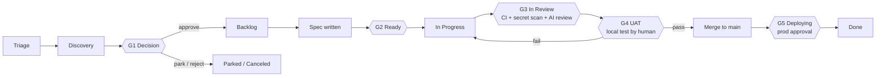

# Human-Agent Agile Methodology (HAAM)

*De l'idée à la production, avec des humains qui décident et des agents qui exécutent.*

HAAM est le modèle de fonctionnement qui décrit comment des humains et des agents de code (Claude Code, Cursor, Codex, Grok ou tout autre) construisent ensemble ce produit.
C'est la source de vérité unique pour **les étapes, les flux, les statuts, les portes et qui a le droit de faire quoi**.
`AGENTS.md` le résume pour les agents ; si les deux divergent un jour, ce fichier l'emporte et `AGENTS.md` doit être corrigé.

---

## 1. Principes

1. **Tout vit dans Git ou dans l'outil de suivi.** Rien d'important n'existe seulement dans une conversation, une mémoire Claude ou la tête de quelqu'un. Toute personne ayant son propre compte Claude peut cloner le dépôt, connecter l'outil de suivi et reprendre là où une autre s'est arrêtée.
2. **L'outil de suivi sert à planifier et suivre le travail. Git contient les connaissances et le code.** L'outil de suivi est un tableau GitHub Projects ou Linear, choisi par projet (`docs/process/TRACKER.md`). Ticket = intention et statut. Dépôt = specs, décisions, architecture, plans UAT, code.
3. **Les humains décident, les agents exécutent.** Les agents peuvent proposer, évaluer, rédiger des specs, construire, tester et préparer l'UAT. Seuls des humains approuvent les idées, approuvent les specs, valident l'UAT, fusionnent dans `main` et approuvent les déploiements en production.
4. **Les portes coûtent peu à passer et cher à sauter.** Un humain peut déroger à n'importe quelle porte, mais chaque dérogation laisse une trace et un ticket de suivi.
5. **De petites tranches.** Un ticket → une branche → une PR, relisible en ~15 minutes. Tout ce qui est plus gros est découpé avant d'arriver en `Ready`.

---

## 2. Les trois flux de travail

Les agents puisent le travail dans trois flux. Ils se ressemblent dans l'outil de suivi (ce sont des issues) mais se distinguent par leur label et suivent des chemins légèrement différents.

| Flux | Label | Commence en | Source typique | Chemin |
|---|---|---|---|---|
| **Idées** | `stream:idea` | Triage | N'importe qui : vous, un client, un agent qui remarque quelque chose | Cycle de vie complet (toutes les portes) |
| **Fonctionnalités** | `stream:feature` | Backlog | Idées approuvées, éléments de la feuille de route | Spec → construction → UAT → déploiement |
| **Problèmes (bugs)** | `stream:bug` | Triage | Utilisateurs, monitoring, échecs d'UAT | Chemin court : reproduction → correction → vérification en UAT → déploiement |

Quand une idée est approuvée à la porte G1, son label passe de `stream:idea` à `stream:feature`. Elle garde le même identifiant d'issue, si bien que tout l'historique reste au même endroit.

### Epics
Une **epic** est une issue parente (label `epic`) qui regroupe les issues qui composent une fonctionnalité, avec un brief dans `docs/epics/` qui contient le contexte : pour qui, le résultat attendu, le périmètre, les tranches et leur ordre. Elle passe par Triage, Discovery et Decision comme une idée, si bien que G1 est décidée une seule fois pour toute la fonctionnalité (`/decide` s'applique aussi à ses sous-issues de type idée). Ensuite, chaque sous-issue reçoit sa spec, passe G2 et est construite séparément ; l'epic elle-même n'est jamais construite. L'epic passe en In Progress quand sa première sous-issue est réservée et elle est close quand la dernière est livrée. Le regroupement et la mise en forme se font avec le product owner : `/triage group` et `/epic` (`docs/process/PRODUCT-MANAGER.md` §4).

---

## 3. Étapes et statuts

| # | Statut | Catégorie Linear (Linear uniquement) | Signification | Qui l'y place |
|---|---|---|---|---|
| 1 | **Triage** | Triage | Nouvelle idée ou nouveau bug, pas encore évalué | N'importe qui (`/idea`, `/bug`) |
| 2 | **Discovery** | Backlog | En cours d'évaluation (valeur, effort, risque, spike de faisabilité), ou en construction sous forme de prototype jetable que le product owner pourra essayer | Agent (`/assess`, ou `/spike` quand le product owner a choisi `prototype`) |
| 3 | **Decision** | Backlog | Évaluation ou prototype terminé, en attente d'une décision humaine (**G1**) | Agent, après `/assess` ou `/spike` |
| 4 | **Backlog** | Backlog | Approuvé, priorisé, a besoin d'une spec | Humain (`/decide approve`) |
| 5 | **Ready** | Unstarted | Spec approuvée, Definition of Ready remplie (**G2**), label `agent-ready` | Un humain approuve la spec |
| 6 | **In Progress** | Started | Un agent ou un développeur l'a réservée et la construit | Agent (`/build`) |
| 7 | **In Review** | Started | PR prête pour la revue, CI en cours, revue de code (**G3**) | Test d'abord : `publish`, quand le product owner valide le test. Vérifications d'abord : automatisation de l'outil de suivi quand la PR est marquée prête (intégration Linear / workflow `tracker-sync`) ; les brouillons restent en In Progress |
| 8 | **UAT** | Started | Plan UAT prêt, en attente du test local par un humain (**G4**). Test d'abord : avant que la PR n'existe ; vérifications d'abord : une fois la CI au vert | Agent (`/uat`) |
| 9 | **Deploying** | Started | Fusionnée dans `main`, déploiement en production en attente d'approbation (**G5**) | Automatisation de l'outil de suivi à la fusion de la PR |
| 10 | **Done** | Completed | En production et vérifiée | Humain (`/release`) |
| – | **Parked** | Canceled | Bonne idée, mais pas maintenant. Revue lors de la revue du backlog | Humain |
| – | **Canceled** | Canceled | Ne sera pas faite | Humain |

**Ordre « test d'abord » (par défaut, `"flow": "test-first"`) :** le product owner teste avant qu'une PR n'existe ; après In Progress, l'issue passe donc en **UAT** (G4, sur la branche poussée par l'agent), puis, une fois le test validé, en **In Review** (la PR s'ouvre et les vérifications et revues de G3 tournent une seule fois, sur le commit testé), puis en Deploying et Done. Un test en échec, ou une vérification en échec, la renvoie en Ready avec `uat-failed` ; du code modifié est toujours testé à nouveau. Les projets qui préfèrent les vérifications d'abord (`"flow": "checks-first"`) suivent l'ordre du tableau. Dans les deux cas, une validation appartient au commit testé : un push ultérieur retire `uat-passed`.

**Voie sans UAT (`uat:skip`) :** pour les modifications que le product owner ne peut pas vraiment tester (une mise à jour du kit ou de la configuration, une mise à jour de dépendance, une refactorisation invisible, la CI), il marque l'issue `uat:skip` au moment du tri ou de l'approbation de sa spec. L'agent saute alors l'UAT : la PR s'ouvre tout de suite, la CI et les deux revues IA tournent, la porte passe parce que le product owner a marqué l'issue, et sur GitHub Projects la PR est fusionnée toute seule (auto-merge ; sur Linear, c'est le product owner qui la livre). L'issue passe In Progress → In Review → Deploying, puis en Done au prochain `ship` du product owner, quel qu'il soit : le déploiement en production a toujours besoin de son approbation, et un déploiement embarque toutes les modifications fusionnées avant lui. Jamais pour les zones protégées (`human-review`). (Sur Linear, son intégration GitHub peut marquer l'issue Done au moment de la fusion, avant le déploiement.)

**Prototypes et mode de construction par epic :** deux façons de laisser les agents construire vite de gros morceaux sans assouplir les portes (`docs/setup/DECISIONS.md` §8).
- **Le prototype d'abord** (`/spike`) : un agent construit une version fonctionnelle jetable sur une branche `spike/`, avant la décision ou la spec. Le product owner l'essaie et répond `discard`, `change`, `rebuild` ou `keep`. Un spike n'est jamais fusionné. Ce qui est gardé passe par `/spec` et les portes habituelles.
- **Le mode de construction par epic** (label `mode:epic-build`) : un agent principal construit toutes les tranches d'une epic approuvée sur une seule branche, avec un point d'étape après chaque tranche. Le product owner teste et livre toute la fonctionnalité en une fois.

**Livrer par lots :** `/test all` teste tout ce qui attend en une seule session, et `ship --all` fusionne ce qui a été validé ainsi que ce que la voie sans UAT a fusionné, puis approuve **un seul** déploiement en production pour l'ensemble (les exécutions de déploiement plus anciennes en attente sont annulées : la plus récente embarque toutes les modifications).

Les bugs sautent Discovery et Decision : **Triage → Ready → In Progress → UAT → In Review → Deploying → Done** (vérifications d'abord : In Review avant UAT). Un agent ne peut faire passer un bug de Triage à Ready que s'il a écrit les étapes de reproduction et une hypothèse de cause racine confirmée ; la priorité reste du ressort d'un humain.

---

## 4. Étape par étape

### Étape 1 : capture de l'idée (Triage)
- **Entrée :** une phrase, une note vocale, un e-mail de client.
- **Skill :** `/idea <description>`.
- **Sortie :** une issue dans l'outil de suivi avec le label `stream:idea`, au statut Triage, remplie à partir de `docs/templates/idea.md` (problème, pour qui, pourquoi maintenant, signal de succès approximatif).
- **Règle :** la capture est rapide et ne coûte rien. Pas encore de jugement.

### Étape 2 : évaluation et faisabilité (Discovery)
- **Skill :** `/assess APP-123`.
- **L'agent produit** `docs/assessments/APP-123-<slug>.md` à partir de `docs/templates/assessment.md` :
  - Valeur : qui en profite, dans quelle mesure, quelles preuves.
  - Effort : taille T-shirt (XS/S/M/L/XL) justifiée à partir du code réel.
  - Risque : sécurité, protection des données, réglementation, exploitation.
  - Faisabilité technique : quelles parties du code changent, les inconnues, et **un spike facultatif** sur une branche jetable `spike/app-123-<slug>` qui n'est **jamais fusionnée**.
  - Options : au moins deux façons de faire, plus « ne rien faire ».
  - Recommandation : approuver / mettre de côté / rejeter, avec une suggestion de priorité.
- L'évaluation est commitée (via une petite PR ou directement sur une branche `docs/`, voir §8) et liée depuis l'issue. Le statut passe en **Decision**.

### Étape 3 : décision (porte G1, humain)
- **Skill :** `/decide APP-123 approve|park|reject [priority] [notes]` (lancé uniquement par un humain).
- Approuver → statut **Backlog**, le label `stream:idea` est remplacé par `stream:feature`, la priorité est fixée.
- Mettre de côté → **Parked** avec une note « à revoir quand ». Rejeter → **Canceled** avec une raison.
- Si la décision implique un choix technique que les futurs agents doivent respecter, un ADR est rédigé dans `docs/decisions/`.

### Étape 4 : spécification (Backlog → Ready, porte G2)
- **Skill :** `/spec APP-123`.
- L'agent rédige `docs/specs/APP-123-<slug>.md` à partir de `docs/templates/feature-spec.md` : user stories, critères d'acceptation au format Given/When/Then, périmètre et hors périmètre, fichiers probablement touchés, impact sur les données et les migrations, plan de test (unitaires + UAT), déploiement progressif et retour arrière.
- Si le travail dépasse ~1 jour de travail d'agent ou ~400 lignes modifiées, l'agent **le découpe** en sous-issues, chacune avec sa propre section de spec.
- La spec est commitée sur la branche propre à l'issue (sans PR) et liée dans l'issue. Quand l'humain l'approuve (« spec approved » dans la conversation ou en commentaire de l'issue), l'agent ou l'humain ajoute le label `agent-ready` et passe l'issue en **Ready**. La spec est ensuite livrée avec le code dans une seule PR. (Une spec découpée en sous-issues d'une epic a droit à une PR de docs, pour que chaque tranche puisse la lire depuis `main`.)
- La **Definition of Ready** se trouve dans `docs/process/GATES.md`.

### Étape 5 : construction (In Progress)
- **Skill :** `/build APP-123` ou `/next` (l'agent prend l'élément en tête de liste).
- Protocole de réservation (voir §7), puis : créer une branche à partir de `main` avec le nom de branche de l'issue (`123-short-title` sur GitHub, le nom de branche de Linear sur Linear), implémenter en suivant les critères d'acceptation, **écrire des tests unitaires pour chaque critère d'acceptation**, lancer `make check` en local jusqu'à ce que tout soit au vert, mettre à jour la documentation touchée par la modification, ouvrir une PR dont le titre commence par l'identifiant de l'issue.

### Étape 6 : vérification automatique et revue de code (In Review, porte G3)
- **Vérifications déterministes** sur chaque PR : `ci` (lint, types, tests unitaires, build), `secrets` (gitleaks sur chaque commit), `dependencies` (audit des vulnérabilités).
- **Agent relecteur indépendant** : un Claude distinct qui tourne dans GitHub Actions et n'a jamais vu le code s'écrire relit le diff par rapport à la spec et à `AGENTS.md` (`ai-review`), et une revue dédiée à la sécurité cherche les vulnérabilités (`security-review` : la revue de sécurité d'Anthropic avec une clé d'API, ou une session Claude qui suit `.github/review/SECURITY-REVIEWER.md` avec un token de plan Claude). L'un ou l'autre secret fait tourner les deux, et leurs instructions viennent de `main`. Ils publient des commentaires et peuvent bloquer ; ils ne peuvent ni approuver ni fusionner.
- L'agent qui construit corrige les points bloquants (deux tours au maximum, ensuite il passe la main à un humain). Seul un humain peut passer outre une revue IA (label `ai-review-overruled`).
- La **revue humaine** est obligatoire pour les zones protégées (label `human-review`).
- Tous les détails : `docs/process/GATES.md` § Comment fonctionne la revue de code.

### Étape 7 : test d'acceptation utilisateur (UAT, porte G4, humain)
- **Skill :** `/uat APP-123` (l'agent prépare), puis l'humain tape `/test` (ou enregistre un résultat avec `/uat-result APP-123 pass|fail`).
- L'agent rédige `docs/uat/APP-123-<slug>.md` à partir de `docs/templates/uat-plan.md` (test d'abord : quand `make check` passe sur sa branche poussée ; vérifications d'abord : quand la CI est au vert sur la PR) : comment lancer en local (`make dev` sur la branche), données de test, étapes numérotées avec résultats attendus et cases à cocher, cas limites, ce qui est hors périmètre.
- L'agent publie une version courte dans l'issue et la passe en **UAT**. L'humain est prévenu par l'outil de suivi.
- L'humain teste d'abord en **local** : `/test` met la modification en place et le guide dans le plan. Validé → test d'abord : la PR s'ouvre avec le label `uat-passed` et les vérifications tournent une seule fois, sur le commit testé ; vérifications d'abord : la PR reçoit le label `uat-passed`. Un push ultérieur retire le label, si bien que du code modifié est testé à nouveau. Échec → les échecs sont consignés sous forme de liste dans l'issue, qui reçoit le label `uat-failed` et repart en **Ready** ; les agents corrigent les éléments `uat-failed` avant tout le reste, et la correction revient en UAT.

### Étape 8 : release (Deploying → Done, porte G5, humain)
- Après une validation, `/test` demande à l'humain *« On livre ? »*. Sur `ship`, l'agent (`haam.py ship <ID> --human`) fusionne la PR (l'outil de suivi passe l'issue en **Deploying**), approuve le déploiement `production` en attente au nom de l'humain, attend qu'il se termine, lance le smoke test s'il est défini et clôt l'issue en **Done**. L'humain peut aussi faire chaque étape à la main : fusionner, approuver le déploiement dans GitHub, puis `/release APP-123`.
- La note de version (`docs/changes/<FILE-ID>.md`, un fichier par modification) est ajoutée sur la branche de la PR par `/uat`, pour être livrée avec la modification.

---

## 5. Rôles

| Rôle | Qui | Peut faire |
|---|---|---|
| **Product owner** | La personne responsable des décisions produit (une par produit) | Tout. Responsable de G1, de l'approbation en G2, de G4, de G5, des dérogations et des priorités |
| **Développeur** | Toute personne qui contribue avec son propre compte Claude | Capturer, évaluer, rédiger des specs, construire, relire, mener l'UAT si le product owner le lui délègue ; fusionner avec l'accord du product owner |
| **Agent** | Toute session d'agent de code dans ce dépôt, quel que soit l'outil | Capturer, évaluer, faire un spike, rédiger des specs, construire, tester, ouvrir des PR, préparer l'UAT, mettre à jour les statuts dans l'outil de suivi jusqu'à **UAT**. **Jamais** : décider G1, approuver des specs, poser `uat-passed`, fusionner dans `main`, déployer, poser `gate-override` ou `ai-review-overruled`, relire ses propres PR |

---

## 6. Priorités

La priorité de l'outil de suivi (la priorité intégrée de Linear, ou le champ Priority du tableau sur GitHub Projects) est la seule source de priorité.

| Priorité | Signification | Traitement attendu |
|---|---|---|
| Urgent | Production cassée ou échéance légale/de conformité menacée | On laisse tout tomber. Dérogation autorisée |
| High | Important pour les objectifs actuels | À faire ensuite |
| Medium | Normal | Dans l'ordre |
| Low | Bien d'avoir | Quand il n'y a rien d'autre |
| No priority | Pas encore trié | Les agents ne les construisent pas |

Ordre au sein d'une même priorité : les bugs avant les fonctionnalités, les plus anciens avant les plus récents, les plus petits avant les plus gros.

Comment trier et choisir les priorités (niveaux, impact × portée des bugs, valeur/confiance/taille, tailles saines des files d'attente) : `docs/process/PRODUCT-MANAGER.md`. Le product owner peut le faire avec un agent (`/triage`) ou directement dans l'outil de suivi.

---

## 7. Travailler en parallèle (plusieurs humains, plusieurs agents)

1. **La réservation se fait dans l'outil de suivi, pas dans la conversation.** Avant de construire, un agent relit l'issue. Si elle est déjà *In Progress* ou assignée à quelqu'un d'autre, il la laisse. Sinon, il l'assigne à l'humain qui mène la session, la passe en *In Progress* et publie un commentaire : ``🤖 Claimed by <name> via <tool> [on <machine>] · branch `<branch>` ``.
2. **Une issue par session, un dossier par conversation.** Une session travaille sur une seule issue à la fois. Pour faire tourner plusieurs agents à la fois sur une machine, chaque conversation a son propre worktree git, pour ne pas partager de répertoire de travail : commencez chaque conversation d'agent par `/work` (voir `docs/ONBOARDING.md`).
3. **Les noms de branche viennent de l'issue** (`123-short-title` sur GitHub, `app-123-short-title` sur Linear), si bien que le lien avec l'issue est automatique.
4. **Rebasez toujours sur un `main` à jour** avant d'ouvrir ou de mettre à jour une PR.
5. **Pas d'état personnel dans les fichiers partagés.** Les préférences personnelles vont dans des fichiers ignorés par git (`CLAUDE.local.md`, `AGENTS.local.md`, `.claude/settings.local.json`…).
6. **Note de passation.** Si une session s'arrête avant la fin, l'agent publie un commentaire dans l'issue : fait / pas fait / étape suivante / pièges, et pousse la branche (vérifications d'abord : en PR brouillon ; test d'abord : sans PR). N'importe qui peut reprendre à partir de là.

---

## 8. Où vit chaque artefact

| Artefact | Emplacement | Créé par |
|---|---|---|
| Idée, bug, statut, priorité, discussion | Issue dans l'outil de suivi | `/idea`, `/bug` |
| Évaluation et faisabilité | `docs/assessments/APP-123-*.md` | `/assess` |
| Code du spike | branche `spike/app-123-*` (jamais fusionnée ; refusée par la porte de release) | `/assess`, `/spike` |
| Enregistrement de décision (technique) | `docs/decisions/NNNN-*.md` (ADR) | `/decide`, `/spec` |
| Brief d'epic | `docs/epics/APP-123-*.md` | `/epic` |
| Spec de fonctionnalité | `docs/specs/APP-123-*.md` | `/spec` |
| Code + tests unitaires | `src/`, `tests/` (selon la stack) | `/build` |
| Plan UAT | `docs/uat/APP-123-*.md` (résultats : commentaires dans l'issue et la PR) | `/uat`, `/test` |
| Notes de version | `docs/changes/<FILE-ID>.md` (une par modification) ; `CHANGELOG.md` quand vous publiez une version | `/uat` |
| Contexte produit | `docs/product/PRODUCT.md` | Humains |
| Carte de l'architecture | `docs/product/ARCHITECTURE.md` | Les agents la tiennent à jour |

Les évaluations et les specs vivent sur la branche de l'issue et sont livrées avec le code : la plupart des issues ont donc besoin d'une seule PR, pas de trois. Les PR qui ne contiennent que de la documentation (briefs d'epic, specs découpées) ne coûtent pas grand-chose : la CI et les revues IA les sautent, et la porte UAT ne s'applique pas.

---

## 9. Rituels (légers)

- **Tri quotidien (10–15 min, humain) :** tester ce qui est en *UAT*, vider *Triage* (`/triage`).
- **Revue hebdomadaire du backlog (30 min, humain) :** passer en revue *Decision* (décider), *Parked* (revoir), *Backlog* (re-prioriser, `/triage backlog`), le travail bloqué (`/triage stale`).
- Le rythme complet et les listes de contrôle pour le product owner : `docs/process/PRODUCT-MANAGER.md`.
- **Quotidien, facultatif :** une tâche Claude planifiée vous envoie un résumé : ce qui a bougé, ce qui est bloqué, ce qui vous attend.
