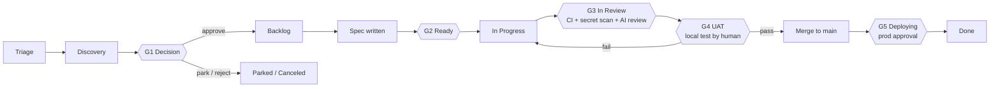

# Human-Agent Agile Methodology (HAAM)

*Dall'idea alla produzione, con le persone che decidono e gli agenti che eseguono.*

HAAM è il modello operativo con cui le persone e gli agenti di coding (Claude Code, Cursor, Codex, Grok o qualsiasi altro) costruiscono insieme questo prodotto.
È l'unica fonte di verità per **fasi, flussi, stati, gate e chi può fare cosa**.
`AGENTS.md` lo riassume per gli agenti; se dovessero mai contraddirsi, vale questo file e `AGENTS.md` va corretto.

---

## 1. Principi

1. **Tutto vive in Git o nel tracker.** Niente di importante esiste solo in una chat, in una memoria di Claude o nella testa di qualcuno. Chiunque abbia il proprio account Claude può clonare il repo, collegare il tracker e riprendere da dove chiunque altro si è fermato.
2. **Il lavoro si pianifica e si traccia nel tracker. Conoscenza e codice vivono in Git.** Il tracker è una board di GitHub Projects o Linear, scelto per ogni progetto (`docs/process/TRACKER.md`). Ticket = intenzione e stato. Repo = specifiche, decisioni, architettura, piani di UAT, codice.
3. **Le persone decidono, gli agenti eseguono.** Gli agenti possono proporre, valutare, scrivere specifiche, costruire, testare e preparare la UAT. Solo le persone approvano le idee, approvano le specifiche, superano la UAT, fanno il merge su `main` e approvano i deploy in produzione.
4. **I gate costano poco da superare e molto da saltare.** Una persona può scavalcare qualsiasi gate, ma ogni override lascia una traccia e un ticket di follow-up.
5. **Porzioni piccole.** Un ticket → un branch → una PR, revisionabile in ~15 minuti. Tutto ciò che è più grande si divide prima di arrivare a `Ready`.

---

## 2. I tre flussi di lavoro

Gli agenti prendono il lavoro da tre flussi. Nel tracker hanno lo stesso aspetto (issue), ma si distinguono per etichetta e seguono percorsi leggermente diversi.

| Flusso | Etichetta | Parte da | Fonte tipica | Percorso |
|---|---|---|---|---|
| **Idee** | `stream:idea` | Triage | Chiunque: tu, un cliente, un agente che nota qualcosa | Ciclo di vita completo (tutti i gate) |
| **Feature** | `stream:feature` | Backlog | Idee approvate, elementi della roadmap | Specifica → build → UAT → deploy |
| **Problemi (bug)** | `stream:bug` | Triage | Utenti, monitoraggio, UAT fallite | Percorso breve: riproduzione → correzione → verifica in UAT → deploy |

Quando un'idea viene approvata al Gate G1, la sua etichetta passa da `stream:idea` a `stream:feature`. Mantiene lo stesso ID di issue, così tutta la storia resta in un unico posto.

### Epic
Una **epic** è una issue padre (etichetta `epic`) che raggruppa le issue che compongono una feature, con un brief in `docs/epics/` che contiene il contesto: per chi è, il risultato atteso, l'ambito, le porzioni e l'ordine. Passa per Triage, Discovery e Decision come un'idea, così il G1 si decide una volta sola per tutta la feature (`/decide` si applica anche alle sue sotto-issue di tipo idea). Dopo, ogni sotto-issue riceve la sua specifica, supera il G2 e viene costruita per conto suo; l'epic in sé non si costruisce mai. L'epic passa a In Progress quando viene presa in carico la prima sotto-issue e si chiude quando viene rilasciata l'ultima. Il raggruppamento e la definizione si fanno con il product owner: `/triage group` e `/epic` (`docs/process/PRODUCT-MANAGER.md` §4).

---

## 3. Fasi e stati

| # | Stato | Categoria Linear (solo Linear) | Significato | Chi lo sposta qui |
|---|---|---|---|---|
| 1 | **Triage** | Triage | Nuova idea o bug, non ancora valutato | Chiunque (`/idea`, `/bug`) |
| 2 | **Discovery** | Backlog | In valutazione (valore, sforzo, rischio, spike di fattibilità), oppure costruita come prototipo usa e getta da far provare all'owner | Agente (`/assess`, oppure `/spike` quando l'owner ha scelto `prototype`) |
| 3 | **Decision** | Backlog | Valutazione o prototipo completati, in attesa di una decisione umana (**G1**) | Agente, dopo `/assess` o `/spike` |
| 4 | **Backlog** | Backlog | Approvata, con priorità, serve una specifica | Persona (`/decide approve`) |
| 5 | **Ready** | Unstarted | Specifica approvata, Definition of Ready soddisfatta (**G2**), etichetta `agent-ready` | Una persona approva la specifica |
| 6 | **In Progress** | Started | Un agente o uno sviluppatore l'ha presa in carico e la sta costruendo | Agente (`/build`) |
| 7 | **In Review** | Started | PR pronta per la revisione, CI in esecuzione, code review (**G3**) | Test-first: `publish`, quando l'owner supera il test. Checks-first: automazione del tracker quando la PR viene marcata come pronta (integrazione Linear / workflow `tracker-sync`); le bozze restano In Progress |
| 8 | **UAT** | Started | Piano di UAT pronto, in attesa che una persona testi in locale (**G4**). Test-first: prima che esista la PR; checks-first: quando la CI è verde | Agente (`/uat`) |
| 9 | **Deploying** | Started | Merge su `main` fatto, deploy in produzione in attesa di approvazione (**G5**) | Automazione del tracker al merge della PR |
| 10 | **Done** | Completed | In produzione e verificata | Persona (`/release`) |
| – | **Parked** | Canceled | Buona idea, ma non ora. Si riprende alla revisione del backlog | Persona |
| – | **Canceled** | Canceled | Non si farà | Persona |

**Ordine test-first (quello predefinito, `"flow": "test-first"`):** l'owner testa prima che esista una PR, quindi dopo In Progress la issue va in **UAT** (G4, sul branch che l'agente ha fatto push), poi, quando l'owner la supera, in **In Review** (la PR si apre e i controlli e le revisioni del G3 girano una sola volta, sul commit testato), poi in Deploying e Done. Un test fallito, o un controllo fallito, la rimanda a Ready con `uat-failed`; il codice modificato si testa sempre di nuovo. I progetti che preferiscono prima i controlli (`"flow": "checks-first"`) usano l'ordine della tabella. In entrambi i casi, un superamento appartiene al commit che è stato testato: un push successivo rimuove `uat-passed`.

**Corsia senza UAT (`uat:skip`):** per le modifiche che l'owner non può testare in modo significativo (un aggiornamento del kit o della configurazione, l'aggiornamento di una dipendenza, un refactoring invisibile, la CI), l'owner marca la issue `uat:skip` quando ne fa il triage o ne approva la specifica. L'agente allora salta la UAT: la PR si apre subito, girano la CI ed entrambe le revisioni AI, il gate passa perché l'owner ha marcato la issue, e su GitHub Projects la PR va in merge da sola (auto-merge; su Linear la rilascia l'owner). La issue va In Progress → In Review → Deploying, e in Done al successivo `ship` dell'owner, di qualunque cosa: il deploy in produzione richiede comunque la sua approvazione, e un deploy porta con sé ogni modifica unita prima. Mai per le aree protette (`human-review`). (Su Linear, la sua integrazione con GitHub può marcare la issue come Done al merge, prima del deploy.)

**Prototipi e modalità di build per epic:** due modi per lasciare che gli agenti costruiscano grandi pezzi in fretta senza allentare i gate (`docs/setup/DECISIONS.md` §8).
- **Prima il prototipo** (`/spike`): un agente costruisce una versione funzionante usa e getta su un branch `spike/`, prima della decisione o della specifica. L'owner la prova e dice `discard`, `change`, `rebuild` o `keep`. Uno spike non va mai in merge. Ciò che si tiene passa per `/spec` e per i gate normali.
- **Modalità di build per epic** (etichetta `mode:epic-build`): un agente capofila costruisce ogni porzione di un'epic approvata su un unico branch, con un checkpoint dopo ogni porzione. L'owner testa e rilascia l'intera feature una volta sola.

**Rilasciare a lotti:** `/test all` testa tutto ciò che è in attesa in una sola sessione, e `ship --all` fa il merge di ciò che è passato più ciò che la corsia ha già unito, poi approva **un solo** deploy in produzione per tutto (le esecuzioni di deploy più vecchie in attesa vengono annullate: la più recente porta con sé ogni modifica).

I bug saltano Discovery e Decision: **Triage → Ready → In Progress → UAT → In Review → Deploying → Done** (checks-first: In Review prima di UAT). Un agente può spostare un bug da Triage a Ready solo quando ha scritto i passi di riproduzione e un'ipotesi confermata sulla causa principale; la priorità resta comunque decisione di una persona.

---

## 4. Fase per fase

### Fase 1: Raccolta dell'idea (Triage)
- **Input:** una frase, un messaggio vocale, l'email di un cliente.
- **Skill:** `/idea <description>`.
- **Output:** una issue nel tracker con etichetta `stream:idea`, stato Triage, compilata a partire da `docs/templates/idea.md` (problema, per chi è, perché ora, segnale di successo approssimativo).
- **Regola:** la raccolta è veloce ed economica. Ancora nessun giudizio.

### Fase 2: Valutazione e fattibilità (Discovery)
- **Skill:** `/assess APP-123`.
- **L'agente produce** `docs/assessments/APP-123-<slug>.md` a partire da `docs/templates/assessment.md`:
  - Valore: chi ne beneficia, quanto, con quali evidenze.
  - Sforzo: taglia (XS/S/M/L/XL) motivata sulla base del codice reale.
  - Rischio: sicurezza, protezione dei dati, normativa, operatività.
  - Fattibilità tecnica: quali parti del codice cambiano, incognite e **uno spike facoltativo** su un branch usa e getta `spike/app-123-<slug>` che **non va mai in merge**.
  - Opzioni: almeno due modi per farlo, più "non fare nulla".
  - Raccomandazione: approvare / parcheggiare / rifiutare, con una priorità suggerita.
- La valutazione viene committata sul branch della issue (senza PR; vedi §8) e collegata dalla issue. Lo stato passa a **Decision**.

### Fase 3: Decisione (Gate G1, umano)
- **Skill:** `/decide APP-123 approve|park|reject [priority] [notes]` (la invoca solo una persona).
- Approvare → stato **Backlog**, etichetta `stream:idea` sostituita da `stream:feature`, priorità impostata.
- Parcheggiare → **Parked** con una nota "da riprendere quando". Rifiutare → **Canceled** con una motivazione.
- Se la decisione comporta una scelta tecnica che i futuri agenti devono rispettare, si scrive una ADR in `docs/decisions/`.

### Fase 4: Specifica (Backlog → Ready, Gate G2)
- **Skill:** `/spec APP-123`.
- L'agente scrive `docs/specs/APP-123-<slug>.md` a partire da `docs/templates/feature-spec.md`: user story, criteri di accettazione in formato Given/When/Then, ambito e fuori ambito, file che probabilmente verranno toccati, impatto su dati/migrazioni, piano di test (unit + UAT), rollout e rollback.
- Se il lavoro supera ~1 giorno di lavoro dell'agente o ~400 righe modificate, l'agente **lo divide** in sotto-issue, ognuna con la propria sezione di specifica.
- La specifica viene committata sul branch della issue (senza PR) e collegata nella issue. Quando la persona approva ("spec approved" in chat o come commento sulla issue), l'agente o la persona aggiunge l'etichetta `agent-ready` e sposta la issue in **Ready**. La specifica poi viene rilasciata insieme al codice in un'unica PR. (Una specifica divisa nelle sotto-issue di un'epic ha una PR di sola documentazione, così ogni porzione può leggerla da `main`.)
- La **Definition of Ready** è in `docs/process/GATES.md`.

### Fase 5: Build (In Progress)
- **Skill:** `/build APP-123` o `/next` (l'agente sceglie l'elemento in cima).
- Protocollo di presa in carico (vedi §7), poi: branch da `main` con il nome di branch della issue (`123-short-title` su GitHub, il nome di branch di Linear su Linear), implementazione rispetto ai criteri di accettazione, **unit test per ogni criterio di accettazione**, `make check` in locale finché non è verde, aggiornamento della documentazione toccata dalla modifica, apertura di una PR il cui titolo inizia con l'ID della issue.

### Fase 6: Verifica automatica e code review (In Review, Gate G3)
- **Controlli deterministici** su ogni PR: `ci` (lint, tipi, unit test, build), `secrets` (gitleaks su ogni commit), `dependencies` (audit delle vulnerabilità).
- **Agente revisore indipendente**: un Claude separato che gira in GitHub Actions, e che non ha mai visto scrivere il codice, rivede il diff rispetto alla specifica e ad `AGENTS.md` (`ai-review`), e una revisione solo di sicurezza cerca vulnerabilità (`security-review`: la security review di Anthropic con una chiave API, oppure una sessione Claude che segue `.github/review/SECURITY-REVIEWER.md` con un token di un piano Claude). Uno qualsiasi dei due secret fa girare entrambe, e le loro istruzioni vengono da `main`. Pubblicano commenti e possono bloccare; non possono approvare né fare il merge.
- L'agente che costruisce corregge i rilievi bloccanti (al massimo due giri, poi passa la mano a una persona). Solo una persona può scavalcare una revisione AI (etichetta `ai-review-overruled`).
- La **revisione umana** è obbligatoria per le aree protette (etichetta `human-review`).
- Tutti i dettagli: `docs/process/GATES.md` § Come funziona la code review.

### Fase 7: Test di accettazione utente (UAT, Gate G4, umano)
- **Skill:** `/uat APP-123` (prepara l'agente), poi la persona scrive `/test` (o registra un risultato con `/uat-result APP-123 pass|fail`).
- L'agente scrive `docs/uat/APP-123-<slug>.md` a partire da `docs/templates/uat-plan.md` (test-first: quando `make check` passa sul branch di cui ha fatto push; checks-first: quando la CI è verde sulla PR): come eseguirlo in locale (`make dev` sul branch), dati di test, passi numerati con risultati attesi e caselle da spuntare, casi limite, cosa è fuori ambito.
- L'agente pubblica una versione breve sulla issue e la sposta in **UAT**. Il tracker avvisa la persona.
- La persona testa prima in **locale**: `/test` prepara la modifica e la guida nel piano. Superato → test-first: la PR si apre con l'etichetta `uat-passed` e i controlli girano una volta, sul commit testato; checks-first: la PR riceve l'etichetta `uat-passed`. Un push successivo rimuove l'etichetta, così il codice modificato si testa di nuovo. Fallito → i problemi vengono registrati come checklist sulla issue, che riceve l'etichetta `uat-failed` e torna in **Ready**; gli agenti correggono gli elementi `uat-failed` prima di qualsiasi altra cosa, e la correzione torna in UAT.

### Fase 8: Rilascio (Deploying → Done, Gate G5, umano)
- Dopo un superamento, `/test` chiede alla persona *"Lo rilascio?"*. Con `ship`, l'agente (`haam.py ship <ID> --human`) fa il merge della PR (il tracker sposta la issue in **Deploying**), approva il deploy `production` in attesa per conto della persona, aspetta che finisca, esegue lo smoke check se definito e chiude la issue come **Done**. La persona può anche fare ogni passo a mano: merge, approvazione del deploy su GitHub, poi `/release APP-123`.
- La nota di rilascio (`docs/changes/<FILE-ID>.md`, un file per modifica) viene aggiunta sul branch della PR da `/uat`, così viene rilasciata insieme alla modifica.

---

## 5. Ruoli

| Ruolo | Chi | Cosa può fare |
|---|---|---|
| **Product owner** | La persona responsabile delle decisioni di prodotto (una per prodotto) | Tutto. Responsabile di G1, approvazione del G2, G4, G5, override, priorità |
| **Sviluppatore** | Qualsiasi persona che contribuisce con il proprio account Claude | Raccogliere, valutare, scrivere specifiche, costruire, revisionare, fare la UAT se delegata dal product owner; fare il merge con l'OK del product owner |
| **Agente** | Qualsiasi sessione di agente di coding in questo repo, con qualunque strumento | Raccogliere, valutare, fare spike, scrivere specifiche, costruire, testare, aprire PR, preparare la UAT, aggiornare gli stati del tracker fino a **UAT**. **Mai**: decidere il G1, approvare specifiche, impostare `uat-passed`, fare il merge su `main`, fare il deploy, applicare `gate-override` o `ai-review-overruled`, revisionare le proprie PR |

---

## 6. Priorità

La priorità del tracker (la priorità nativa di Linear, o il campo Priority della board su GitHub Projects) è l'unica fonte di priorità.

| Priorità | Significato | Gestione prevista |
|---|---|---|
| Urgent | Produzione rotta o una scadenza legale/di compliance a rischio | Si lascia tutto. Override consentito |
| High | Importante per gli obiettivi attuali | La prossima |
| Medium | Normale | In ordine |
| Low | Sarebbe bello averla | Nei tempi morti |
| No priority | Non ancora triagiata | Gli agenti non le costruiscono |

Ordine all'interno della stessa priorità: bug prima delle feature, più vecchie prima delle più nuove, più piccole prima delle più grandi.

Come fare il triage e scegliere le priorità (livelli, impatto × portata dei bug, valore/fiducia/dimensione, dimensioni sane delle code): `docs/process/PRODUCT-MANAGER.md`. Il product owner può farlo con un agente (`/triage`) o direttamente nel tracker.

---

## 7. Lavorare in parallelo (più persone, più agenti)

1. **La presa in carico si fa nel tracker, non in chat.** Prima di costruire, un agente rilegge la issue. Se è già *In Progress* o assegnata a qualcun altro, la salta. Altrimenti la assegna alla persona che sta conducendo la sessione, imposta *In Progress* e pubblica un commento: ``🤖 Claimed by <name> via <tool> [on <machine>] · branch `<branch>` ``.
2. **Una issue per sessione, una cartella per chat.** Una sessione lavora su una issue alla volta. Per far girare più agenti contemporaneamente su una macchina, ogni chat ha il proprio git worktree, così non condividono una directory di lavoro: avvia ogni chat di agente con `/work` (vedi `docs/ONBOARDING.md`).
3. **I nomi dei branch vengono dalla issue** (`123-short-title` su GitHub, `app-123-short-title` su Linear), così il collegamento alla issue è automatico.
4. **Fai sempre rebase su un `main` aggiornato** prima di aprire o aggiornare una PR.
5. **Nessuno stato personale nei file condivisi.** Le preferenze personali vanno in file ignorati da git (`CLAUDE.local.md`, `AGENTS.local.md`, `.claude/settings.local.json`…).
6. **Nota di passaggio di consegne.** Se una sessione si ferma prima di finire, l'agente pubblica un commento sulla issue: fatto / non fatto / prossimo passo / insidie, e fa push del branch (checks-first: come PR in bozza; test-first: senza PR). Chiunque può riprendere da lì.

---

## 8. Dove vive ogni artefatto

| Artefatto | Posizione | Creato da |
|---|---|---|
| Idea, bug, stato, priorità, discussione | Issue nel tracker | `/idea`, `/bug` |
| Valutazione e fattibilità | `docs/assessments/APP-123-*.md` | `/assess` |
| Codice dello spike | branch `spike/app-123-*` (mai in merge; rifiutato dal gate di rilascio) | `/assess`, `/spike` |
| Registro delle decisioni (tecniche) | `docs/decisions/NNNN-*.md` (ADR) | `/decide`, `/spec` |
| Brief dell'epic | `docs/epics/APP-123-*.md` | `/epic` |
| Specifica della feature | `docs/specs/APP-123-*.md` | `/spec` |
| Codice + unit test | `src/`, `tests/` (a seconda dello stack) | `/build` |
| Piano di UAT | `docs/uat/APP-123-*.md` (risultati: commenti sulla issue e sulla PR) | `/uat`, `/test` |
| Note di rilascio | `docs/changes/<FILE-ID>.md` (una per modifica); `CHANGELOG.md` quando chiudi una versione | `/uat` |
| Contesto di prodotto | `docs/product/PRODUCT.md` | Persone |
| Mappa dell'architettura | `docs/product/ARCHITECTURE.md` | Gli agenti la tengono aggiornata |

Valutazioni e specifiche vivono sul branch della issue e vengono rilasciate con il codice, così la maggior parte delle issue richiede una PR, non tre. Le PR di sola documentazione (brief delle epic, specifiche divise) costano poco: la CI e le revisioni AI le saltano, e il gate di UAT non si applica.

---

## 9. Cerimonie (leggere)

- **Triage quotidiano (10–15 min, persona):** testa ciò che è in *UAT*, svuota *Triage* (`/triage`).
- **Revisione settimanale del backlog (30 min, persona):** passa in rassegna *Decision* (decidi), *Parked* (riprendi), *Backlog* (ridai le priorità, `/triage backlog`), il lavoro bloccato (`/triage stale`).
- Il ritmo completo e le checklist per il product owner: `docs/process/PRODUCT-MANAGER.md`.
- **Quotidiano, facoltativo:** un task Claude programmato ti invia un riepilogo: cosa si è mosso, cosa è bloccato, cosa aspetta te.
