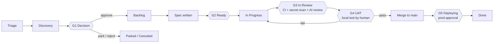

# Human-Agent Agile Methodology (HAAM)

*Van idee tot productie, waarbij mensen beslissen en agents uitvoeren.*

HAAM is het werkmodel voor hoe mensen en coding agents (Claude Code, Cursor, Codex, Grok of een andere) samen dit product bouwen.
Het is de enige bron van waarheid voor **fasen, stromen, statussen, gates en wie wat mag doen**.
`AGENTS.md` vat het samen voor agents; als ze ooit van elkaar afwijken, geldt dit bestand en moet `AGENTS.md` worden aangepast.

---

## 1. Principes

1. **Alles staat in Git of in de tracker.** Niets belangrijks bestaat alleen in een chat, een Claude-geheugen of iemands hoofd. Iedereen met een eigen Claude-account kan de repo clonen, de tracker koppelen en verdergaan waar een ander gebleven was.
2. **In de tracker wordt werk gepland en bijgehouden. In Git staan kennis en code.** De tracker is een GitHub Projects-board of Linear, gekozen per project (`docs/process/TRACKER.md`). Ticket = bedoeling en status. Repo = specs, beslissingen, architectuur, UAT-plannen, code.
3. **Mensen beslissen, agents voeren uit.** Agents kunnen voorstellen, beoordelen, specificeren, bouwen, testen en UAT voorbereiden. Alleen mensen keuren ideeën goed, keuren specs goed, keuren UAT goed, mergen naar `main` en keuren productiedeploys goed.
4. **Een gate passeren is goedkoop, een gate overslaan is duur.** Elke gate kan door een mens worden overruled, maar elke override laat een spoor na en een vervolgticket.
5. **Kleine slices.** Eén ticket → één branch → één PR, te reviewen in ~15 minuten. Alles wat groter is, wordt gesplitst voordat het `Ready` bereikt.

---

## 2. De drie werkstromen

Agents halen werk uit drie stromen. In de tracker zien ze er hetzelfde uit (issues), maar ze worden onderscheiden met een label en volgen net iets andere paden.

| Stroom | Label | Begint in | Typische bron | Pad |
|---|---|---|---|---|
| **Ideeën** | `stream:idea` | Triage | Iedereen: jij, een klant, een agent die iets opmerkt | Volledige levenscyclus (alle gates) |
| **Features** | `stream:feature` | Backlog | Goedgekeurde ideeën, roadmap-items | Spec → bouwen → UAT → deploy |
| **Issues (bugs)** | `stream:bug` | Triage | Gebruikers, monitoring, mislukte UAT's | Kort pad: reproduceren → fixen → verifiëren in UAT → deploy |

Als een idee bij Gate G1 wordt goedgekeurd, verandert het label van `stream:idea` in `stream:feature`. Het houdt hetzelfde issue-ID, zodat de hele geschiedenis op één plek blijft.

### Epics
Een **epic** is een parent-issue (label `epic`) dat de issues groepeert die samen één feature vormen, met een briefing in `docs/epics/` die de context bevat: voor wie het is, het resultaat, de scope, de slices en de volgorde. Een epic gaat door Triage, Discovery en Decision zoals een idee, zodat G1 één keer voor de hele feature wordt beslist (`/decide` geldt ook voor de sub-issues die ideeën zijn). Daarna wordt elk sub-issue apart gespecificeerd, passeert het G2 en wordt het apart gebouwd; de epic zelf wordt nooit gebouwd. De epic gaat naar In Progress als het eerste sub-issue wordt geclaimd en wordt gesloten als het laatste is gereleased. Groeperen en vormgeven doe je samen met de product owner: `/triage group` en `/epic` (`docs/process/PRODUCT-MANAGER.md` §4).

---

## 3. Fasen en statussen

| # | Status | Linear-categorie (alleen Linear) | Betekenis | Wie zet het hier |
|---|---|---|---|---|
| 1 | **Triage** | Triage | Nieuw idee of nieuwe bug, nog niet beoordeeld | Iedereen (`/idea`, `/bug`) |
| 2 | **Discovery** | Backlog | Wordt beoordeeld (waarde, inspanning, risico, haalbaarheidsspike), of wordt als wegwerpprototype gebouwd zodat de product owner het kan uitproberen | Agent (`/assess`, of `/spike` als de product owner voor `prototype` koos) |
| 3 | **Decision** | Backlog | Beoordeling of prototype klaar, wacht op een besluit van een mens (**G1**) | Agent, na `/assess` of `/spike` |
| 4 | **Backlog** | Backlog | Goedgekeurd, geprioriteerd, heeft een spec nodig | Mens (`/decide approve`) |
| 5 | **Ready** | Unstarted | Spec goedgekeurd, Definition of Ready gehaald (**G2**), label `agent-ready` | Mens keurt de spec goed |
| 6 | **In Progress** | Started | Een agent of developer heeft het geclaimd en is aan het bouwen | Agent (`/build`) |
| 7 | **In Review** | Started | PR klaar voor review, CI draait, code review (**G3**) | Test-first: `publish`, als de product owner de test goedkeurt. Checks-first: automatisering van de tracker als de PR op ready wordt gezet (Linear-integratie / `tracker-sync`-workflow); drafts blijven In Progress |
| 8 | **UAT** | Started | UAT-plan klaar, wacht tot een mens lokaal test (**G4**). Test-first: voordat de PR bestaat; checks-first: zodra CI groen is | Agent (`/uat`) |
| 9 | **Deploying** | Started | Gemerged naar `main`, productiedeploy wacht op goedkeuring (**G5**) | Automatisering van de tracker bij het mergen van de PR |
| 10 | **Done** | Completed | Live in productie en geverifieerd | Mens (`/release`) |
| – | **Parked** | Canceled | Goed idee, niet nu. Komt terug bij de backlog-review | Mens |
| – | **Canceled** | Canceled | Gaan we niet doen | Mens |

**Volgorde test-first (de standaard, `"flow": "test-first"`):** de product owner test voordat er een PR bestaat, dus na In Progress gaat het issue naar **UAT** (G4, op de gepushte branch van de agent), daarna, als de test slaagt, naar **In Review** (de PR wordt geopend en de checks en reviews van G3 draaien één keer, op de geteste commit), en dan naar Deploying en Done. Een mislukte test, of een mislukte check, stuurt het terug naar Ready met `uat-failed`; gewijzigde code wordt altijd opnieuw getest. Projecten die de checks liever eerst doen (`"flow": "checks-first"`) gebruiken de volgorde uit de tabel. Hoe dan ook hoort een goedkeuring bij de commit die getest is: een latere push verwijdert `uat-passed`.

**Route zonder UAT (`uat:skip`):** voor wijzigingen die de product owner niet zinvol kan testen (een update van de kit of de config, een dependency-update, een onzichtbare refactor, CI) markeert de product owner het issue met `uat:skip` bij het triëren of bij het goedkeuren van de spec. De agent slaat UAT dan over: de PR wordt direct geopend, CI en beide AI-reviews draaien, de gate slaagt omdat de product owner het issue gemarkeerd heeft, en op GitHub Projects merget de PR vanzelf (auto-merge; op Linear zet de product owner hem live). Het issue gaat In Progress → In Review → Deploying, en naar Done bij de volgende `ship` van de product owner, van wat dan ook: de productiedeploy heeft nog steeds de goedkeuring van de product owner nodig, en één deploy neemt elke wijziging mee die ervoor gemerged is. Nooit voor beschermde gebieden (`human-review`). (Op Linear kan de GitHub-integratie het issue al bij het mergen op Done zetten, vóór de deploy.)

**Prototypes en epic-bouwmodus:** twee manieren om agents snel grote stukken te laten bouwen zonder de gates losser te maken (`docs/setup/DECISIONS.md` §8).
- **Eerst een prototype** (`/spike`): een agent bouwt een werkende wegwerpversie op een `spike/`-branch, vóór de beslissing of de spec. De product owner probeert het uit en zegt `discard`, `change`, `rebuild` of `keep`. Een spike wordt nooit gemerged. Wat behouden blijft, gaat door `/spec` en de normale gates.
- **Epic-bouwmodus** (label `mode:epic-build`): één leidende agent bouwt elke slice van een goedgekeurde epic op één branch, met een checkpoint na elke slice. De product owner test de hele feature en zet die in één keer live.

**In batches uitrollen:** `/test all` test alles wat wacht in één sessie, en `ship --all` merget wat geslaagd is plus wat de route zonder UAT gemerged heeft, en keurt dan **één** productiedeploy voor alles goed (oudere wachtende deploy-runs worden geannuleerd: de nieuwste neemt elke wijziging mee).

Bugs slaan Discovery en Decision over: **Triage → Ready → In Progress → UAT → In Review → Deploying → Done** (checks-first: In Review vóór UAT). Een agent mag een bug alleen van Triage naar Ready zetten als hij reproductiestappen heeft geschreven en een bevestigde hypothese over de oorzaak heeft; de prioriteit blijft bij een mens.

---

## 4. Fase voor fase

### Fase 1: Idee vastleggen (Triage)
- **Input:** een zin, een spraakbericht, een e-mail van een klant.
- **Skill:** `/idea <description>`.
- **Output:** een issue in de tracker met label `stream:idea`, status Triage, ingevuld vanuit `docs/templates/idea.md` (probleem, voor wie, waarom nu, globaal signaal van succes).
- **Regel:** vastleggen is snel en goedkoop. Nog geen oordeel.

### Fase 2: Beoordeling en haalbaarheid (Discovery)
- **Skill:** `/assess APP-123`.
- **De agent maakt** `docs/assessments/APP-123-<slug>.md` vanuit `docs/templates/assessment.md`:
  - Waarde: wie heeft er baat bij, hoeveel, bewijs.
  - Inspanning: T-shirtmaat (XS/S/M/L/XL) met onderbouwing vanuit de echte codebase.
  - Risico: security, gegevensbescherming, regelgeving, operationeel.
  - Technische haalbaarheid: welke delen van de codebase veranderen, onbekenden, en **een optionele spike** op een wegwerpbranch `spike/app-123-<slug>` die **nooit gemerged** wordt.
  - Opties: minstens twee manieren om het te doen, plus "niets doen".
  - Aanbeveling: goedkeuren / parkeren / afwijzen, met een voorstel voor de prioriteit.
- De beoordeling wordt gecommit op de eigen branch van het issue (geen PR; zie §8) en vanuit het issue gelinkt. De status gaat naar **Decision**.

### Fase 3: Beslissing (Gate G1, mens)
- **Skill:** `/decide APP-123 approve|park|reject [priority] [notes]` (alleen door een mens aan te roepen).
- Goedkeuren → status **Backlog**, label `stream:idea` vervangen door `stream:feature`, prioriteit ingesteld.
- Parkeren → **Parked** met een notitie "terugkomen wanneer". Afwijzen → **Canceled** met een reden.
- Als de beslissing een technische keuze bevat waar toekomstige agents zich aan moeten houden, wordt er een ADR geschreven in `docs/decisions/`.

### Fase 4: Specificatie (Backlog → Ready, Gate G2)
- **Skill:** `/spec APP-123`.
- De agent schrijft `docs/specs/APP-123-<slug>.md` vanuit `docs/templates/feature-spec.md`: user stories, acceptatiecriteria in Given/When/Then, scope en buiten scope, bestanden die waarschijnlijk geraakt worden, impact op data/migraties, testplan (unit + UAT), uitrol en rollback.
- Als het werk groter is dan ~1 dag agentwerk of ~400 gewijzigde regels, **splitst de agent het** in sub-issues, elk met een eigen sectie in de spec.
- De spec wordt gecommit op de eigen branch van het issue (geen PR) en op het issue gelinkt. Als de mens hem goedkeurt ("spec approved" in de chat of als commentaar op het issue), voegt de agent of de mens het label `agent-ready` toe en zet het issue op **Ready**. De spec gaat daarna samen met de code in één PR mee. (Een spec die over de sub-issues van een epic is verdeeld, krijgt een docs-PR, zodat elke slice hem vanaf `main` kan lezen.)
- De **Definition of Ready** staat in `docs/process/GATES.md`.

### Fase 5: Bouwen (In Progress)
- **Skill:** `/build APP-123` of `/next` (de agent pakt het bovenste item).
- Claimprotocol (zie §7), daarna: branchen vanaf `main` met de branchnaam van het issue (`123-short-title` op GitHub, de branchnaam van Linear op Linear), implementeren volgens de acceptatiecriteria, **unittests schrijven voor elk acceptatiecriterium**, lokaal `make check` draaien tot het groen is, de docs bijwerken die door de wijziging geraakt worden, een PR openen waarvan de titel begint met het issue-ID.

### Fase 6: Geautomatiseerde verificatie en code review (In Review, Gate G3)
- **Deterministische checks** op elke PR: `ci` (lint, types, unittests, build), `secrets` (gitleaks over elke commit), `dependencies` (audit op kwetsbaarheden).
- **Onafhankelijke reviewer-agent**: een aparte Claude die in GitHub Actions draait en de code nooit heeft zien schrijven, reviewt de diff tegen de spec en `AGENTS.md` (`ai-review`), en een review die alleen naar security kijkt, zoekt naar kwetsbaarheden (`security-review`: de security review van Anthropic met een API-sleutel, of een Claude-sessie die `.github/review/SECURITY-REVIEWER.md` volgt met een token van een Claude-abonnement). Met elk van beide secrets draaien ze allebei, en hun instructies komen van `main`. Ze plaatsen commentaar en kunnen blokkeren; ze kunnen niet goedkeuren of mergen.
- De bouwende agent lost blokkerende bevindingen op (maximaal twee rondes, daarna gaat het naar een mens). Alleen een mens kan een AI-review overrulen (label `ai-review-overruled`).
- **Menselijke review** is verplicht voor beschermde gebieden (label `human-review`).
- Alle details: `docs/process/GATES.md` § Hoe code review werkt.

### Fase 7: Gebruikersacceptatietest (UAT, Gate G4, mens)
- **Skill:** `/uat APP-123` (de agent bereidt voor), daarna typt de mens `/test` (of legt een resultaat vast met `/uat-result APP-123 pass|fail`).
- De agent schrijft `docs/uat/APP-123-<slug>.md` vanuit `docs/templates/uat-plan.md` (test-first: als `make check` slaagt op de gepushte branch; checks-first: als CI groen is op de PR): hoe je het lokaal draait (`make dev` op de branch), testdata, genummerde stappen met verwachte resultaten en vinkvakjes, randgevallen, wat buiten scope is.
- De agent post een korte versie op het issue en zet het op **UAT**. De mens krijgt een melding van de tracker.
- De mens test eerst **lokaal**: `/test` zet de wijziging klaar en loodst de mens door het plan. Geslaagd → test-first: de PR wordt geopend met het label `uat-passed` en de checks draaien één keer, op de geteste commit; checks-first: de PR krijgt het label `uat-passed`. Een latere push verwijdert het label, zodat gewijzigde code opnieuw getest wordt. Gefaald → de fouten worden als checklist op het issue vastgelegd, dat het label `uat-failed` krijgt en teruggaat naar **Ready**; agents lossen `uat-failed`-items op vóór al het andere, en de fix komt terug naar UAT.

### Fase 8: Release (Deploying → Done, Gate G5, mens)
- Na een geslaagde test vraagt `/test` de mens *"Live zetten?"*. Bij `ship` merget de agent (`haam.py ship <ID> --human`) de PR (de tracker zet het issue op **Deploying**), keurt de wachtende `production`-deploy namens de mens goed, wacht erop, draait de smoke check als die bestaat, en sluit het issue als **Done**. De mens kan elke stap ook met de hand doen: mergen, de deploy in GitHub goedkeuren, daarna `/release APP-123`.
- De release note (`docs/changes/<FILE-ID>.md`, één bestand per wijziging) wordt door `/uat` op de branch van de PR toegevoegd, zodat hij met de wijziging meegaat.

---

## 5. Rollen

| Rol | Wie | Mag |
|---|---|---|
| **Product owner** | De persoon die verantwoordelijk is voor productbeslissingen (één per product) | Alles. Eigenaar van G1, goedkeuring bij G2, G4, G5, overrides, prioriteiten |
| **Developer** | Elke menselijke bijdrager met een eigen Claude-account | Vastleggen, beoordelen, specificeren, bouwen, reviewen, UAT uitvoeren als de product owner dat delegeert; mergen met akkoord van de product owner |
| **Agent** | Elke coding-agent-sessie in deze repo, welke tool ook | Vastleggen, beoordelen, spiken, specificeren, bouwen, testen, PR's openen, UAT voorbereiden, statussen in de tracker bijwerken tot en met **UAT**. **Nooit**: G1 beslissen, specs goedkeuren, `uat-passed` zetten, naar `main` mergen, deployen, `gate-override` of `ai-review-overruled` toepassen, de eigen PR's reviewen |

---

## 6. Prioriteiten

De prioriteit in de tracker (de ingebouwde prioriteit van Linear, of het Priority-veld van het board op GitHub Projects) is de enige bron voor prioriteit.

| Prioriteit | Betekenis | Verwachte aanpak |
|---|---|---|
| Urgent | Productie kapot of een wettelijke/compliance-deadline in gevaar | Alles laten vallen. Override toegestaan |
| High | Belangrijk voor de huidige doelen | Als volgende |
| Medium | Normaal | Op volgorde |
| Low | Leuk om te hebben | Als er tijd is |
| No priority | Nog niet getrieerd | Agents bouwen deze niet |

Volgorde binnen dezelfde prioriteit: bugs vóór features, ouder vóór nieuwer, kleiner vóór groter.

Hoe je triëert en prioriteiten kiest (niveaus, impact × bereik voor bugs, waarde/vertrouwen/grootte, gezonde wachtrijgroottes): `docs/process/PRODUCT-MANAGER.md`. De product owner kan het samen met een agent doen (`/triage`) of direct in de tracker.

---

## 7. Parallel werken (meerdere mensen, meerdere agents)

1. **Claimen gebeurt in de tracker, niet in de chat.** Voordat een agent gaat bouwen, leest hij het issue opnieuw. Als het al *In Progress* is of aan iemand anders is toegewezen, slaat hij het over. Anders wijst hij het toe aan de mens die de sessie draait, zet het op *In Progress* en plaatst een commentaar: ``🤖 Claimed by <name> via <tool> [on <machine>] · branch `<branch>` ``.
2. **Eén issue per sessie, één map per chat.** Een sessie werkt aan één issue tegelijk. Om op één machine meerdere agents tegelijk te draaien, krijgt elke chat een eigen git worktree, zodat ze geen werkmap delen: begin elke agent-chat met `/work` (zie `docs/ONBOARDING.md`).
3. **Branchnamen komen van het issue** (`123-short-title` op GitHub, `app-123-short-title` op Linear), zodat de koppeling met het issue automatisch is.
4. **Rebase altijd op een verse `main`** voordat je een PR opent of bijwerkt.
5. **Geen persoonlijke staat in gedeelde bestanden.** Persoonlijke voorkeuren gaan in bestanden die git negeert (`CLAUDE.local.md`, `AGENTS.local.md`, `.claude/settings.local.json`…).
6. **Overdrachtsnotitie.** Als een sessie stopt voordat het werk af is, plaatst de agent een commentaar op het issue: gedaan / niet gedaan / volgende stap / valkuilen, en pusht de branch (checks-first: als draft-PR; test-first: geen PR). Iedereen kan van daaruit verder.

---

## 8. Waar elk artefact staat

| Artefact | Locatie | Gemaakt door |
|---|---|---|
| Idee, bug, status, prioriteit, discussie | Issue in de tracker | `/idea`, `/bug` |
| Beoordeling en haalbaarheid | `docs/assessments/APP-123-*.md` | `/assess` |
| Spike-code | branch `spike/app-123-*` (nooit gemerged; geweigerd door de release-gate) | `/assess`, `/spike` |
| Beslissingsverslag (technisch) | `docs/decisions/NNNN-*.md` (ADR) | `/decide`, `/spec` |
| Epic-briefing | `docs/epics/APP-123-*.md` | `/epic` |
| Feature-spec | `docs/specs/APP-123-*.md` | `/spec` |
| Code + unittests | `src/`, `tests/` (per stack) | `/build` |
| UAT-plan | `docs/uat/APP-123-*.md` (resultaten: commentaar op het issue en de PR) | `/uat`, `/test` |
| Release notes | `docs/changes/<FILE-ID>.md` (één per wijziging); `CHANGELOG.md` als je een versie uitbrengt | `/uat` |
| Productcontext | `docs/product/PRODUCT.md` | Mensen |
| Architectuurkaart | `docs/product/ARCHITECTURE.md` | Agents houden hem actueel |

Beoordelingen en specs staan op de branch van het issue en gaan met de code mee, dus de meeste issues hebben één PR nodig, niet drie. PR's met alleen docs (epic-briefings, gesplitste specs) zijn goedkoop: CI en de AI-reviews slaan ze over, en de UAT-gate geldt niet.

---

## 9. Ceremonies (licht)

- **Dagelijkse triage (10–15 min, mens):** test wat er in *UAT* staat, maak *Triage* leeg (`/triage`).
- **Wekelijkse backlog-review (30 min, mens):** loop *Decision* door (beslissen), *Parked* (opnieuw bekijken), *Backlog* (opnieuw prioriteren, `/triage backlog`), vastgelopen werk (`/triage stale`).
- Het volledige ritme en de checklists voor de product owner: `docs/process/PRODUCT-MANAGER.md`.
- **Dagelijks, optioneel:** een geplande Claude-taak stuurt je een overzicht: wat er bewogen heeft, wat er geblokkeerd is, wat er op jou wacht.
