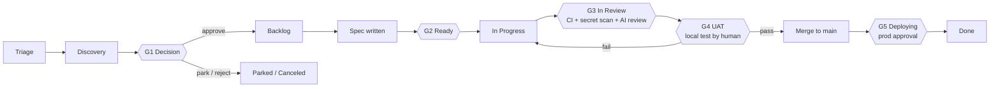

# Human-Agent Agile Methodology (HAAM)

*Da ideia à produção, com pessoas decidindo e agentes executando.*

O HAAM é o modelo operacional de como pessoas e agentes de programação (Claude Code, Cursor, Codex, Grok ou qualquer outro) constroem este produto juntos.
Ele é a única fonte de verdade para **etapas, fluxos de trabalho, status, gates e quem pode fazer o quê**.
O `AGENTS.md` o resume para os agentes; se algum dia os dois discordarem, vale este arquivo, e o `AGENTS.md` deve ser corrigido.

---

## 1. Princípios

1. **Tudo fica no Git ou no tracker.** Nada importante existe apenas em um chat, em uma memória do Claude ou na cabeça de alguém. Qualquer pessoa com a própria conta do Claude pode clonar o repo, conectar o tracker e continuar de onde outra pessoa parou.
2. **O tracker é onde o trabalho é planejado e acompanhado. O Git é onde ficam o conhecimento e o código.** O tracker é um quadro do GitHub Projects ou o Linear, escolhido para cada projeto (`docs/process/TRACKER.md`). Ticket = intenção e status. Repo = specs, decisões, arquitetura, planos de UAT, código.
3. **Os humanos decidem, os agentes executam.** Os agentes podem propor, avaliar, escrever specs, construir, testar e preparar o UAT. Só pessoas aprovam ideias, aprovam specs, aprovam o UAT, fazem merge na `main` e aprovam deploys para produção.
4. **Os gates são baratos de passar e caros de pular.** Qualquer gate pode ser contornado por uma pessoa, mas todo override deixa um rastro e um ticket de acompanhamento.
5. **Partes pequenas.** Um ticket → uma branch → um PR, revisável em ~15 minutos. Qualquer coisa maior é dividida antes de chegar a `Ready`.

---

## 2. Os três fluxos de trabalho

Os agentes puxam trabalho de três fluxos. No tracker eles parecem iguais (issues), mas se distinguem pela label e seguem caminhos um pouco diferentes.

| Fluxo | Label | Começa em | Origem típica | Caminho |
|---|---|---|---|---|
| **Ideias** | `stream:idea` | Triage | Qualquer pessoa: você, um cliente, um agente que percebeu algo | Ciclo de vida completo (todos os gates) |
| **Funcionalidades** | `stream:feature` | Backlog | Ideias aprovadas, itens do roadmap | Spec → construção → UAT → deploy |
| **Problemas (bugs)** | `stream:bug` | Triage | Usuários, monitoramento, falhas no UAT | Caminho curto: reprodução → correção → verificação no UAT → deploy |

Quando uma ideia é aprovada no gate G1, a label dela muda de `stream:idea` para `stream:feature`. Ela mantém o mesmo ID de issue, para que todo o histórico fique em um só lugar.

### Epics
Um **epic** é uma issue pai (label `epic`) que agrupa as issues que compõem uma funcionalidade, com um briefing em `docs/epics/` que guarda o contexto: para quem é, o resultado esperado, o escopo, as partes e a ordem. Ele passa por Triage, Discovery e Decision como uma ideia, de modo que o G1 é decidido uma única vez para a funcionalidade inteira (`/decide` também se aplica às sub-issues de ideia dele). Depois disso, cada sub-issue recebe a própria spec, passa pelo G2 e é construída separadamente; o epic em si nunca é construído. O epic passa para In Progress quando a primeira sub-issue é reservada e é fechado quando a última é lançada. O agrupamento e a definição do epic são feitos com o product owner: `/triage group` e `/epic` (`docs/process/PRODUCT-MANAGER.md` §4).

---

## 3. Etapas e status

| # | Status | Categoria no Linear (só Linear) | Significado | Quem a move para cá |
|---|---|---|---|---|
| 1 | **Triage** | Triage | Ideia ou bug novo, ainda não avaliado | Qualquer pessoa (`/idea`, `/bug`) |
| 2 | **Discovery** | Backlog | Em avaliação (valor, esforço, risco, spike de viabilidade), ou sendo construída como protótipo descartável para o product owner experimentar | Agente (`/assess`, ou `/spike` quando o product owner escolheu `prototype`) |
| 3 | **Decision** | Backlog | Avaliação ou protótipo concluído, esperando a decisão de uma pessoa (**G1**) | Agente, depois de `/assess` ou `/spike` |
| 4 | **Backlog** | Backlog | Aprovada, priorizada, precisa de uma spec | Pessoa (`/decide approve`) |
| 5 | **Ready** | Unstarted | Spec aprovada, Definition of Ready atendida (**G2**), label `agent-ready` | Uma pessoa aprova a spec |
| 6 | **In Progress** | Started | Um agente ou desenvolvedor reservou a issue e está construindo | Agente (`/build`) |
| 7 | **In Review** | Started | PR pronto para revisão, CI rodando, revisão de código (**G3**) | Test-first: `publish`, quando o product owner aprova o teste. Checks-first: automação do tracker quando o PR é marcado como pronto (integração do Linear / workflow `tracker-sync`); os rascunhos ficam em In Progress |
| 8 | **UAT** | Started | Plano de UAT pronto, esperando que uma pessoa teste localmente (**G4**). Test-first: antes de o PR existir; checks-first: quando o CI está verde | Agente (`/uat`) |
| 9 | **Deploying** | Started | Merge feito na `main`, deploy para produção esperando aprovação (**G5**) | Automação do tracker no merge do PR |
| 10 | **Done** | Completed | Em produção e verificada | Pessoa (`/release`) |
| – | **Parked** | Canceled | Boa ideia, mas não agora. Revista na revisão do backlog | Pessoa |
| – | **Canceled** | Canceled | Não será feita | Pessoa |

**Ordem test-first (o padrão, `"flow": "test-first"`):** o product owner testa antes de existir qualquer PR, então depois de In Progress a issue vai para **UAT** (G4, na branch enviada pelo agente) e, quando ele aprova, para **In Review** (o PR é aberto e as verificações e revisões do G3 rodam uma única vez, sobre o commit testado), depois Deploying e Done. Um teste que falha, ou uma verificação que falha, a manda de volta para Ready com `uat-failed`; código alterado é sempre testado de novo. Projetos que preferem as verificações primeiro (`"flow": "checks-first"`) usam a ordem da tabela. Em qualquer caso, uma aprovação pertence ao commit que foi testado: um push posterior remove `uat-passed`.

**Via sem UAT (`uat:skip`):** para mudanças que o product owner não tem como testar de forma útil (uma atualização do kit ou de configuração, uma atualização de dependência, uma refatoração invisível, CI), ele marca a issue com `uat:skip` ao fazer a triagem ou ao aprovar a spec. O agente então pula o UAT: o PR é aberto na hora, o CI e as duas revisões por IA rodam, o gate passa porque o product owner marcou a issue e, no GitHub Projects, o PR faz merge sozinho (auto-merge; no Linear, o product owner o coloca em produção). A issue vai de In Progress → In Review → Deploying, e para Done no próximo `ship` que o product owner fizer, de qualquer coisa: o deploy para produção continua precisando da aprovação dele, e um deploy leva todas as mudanças que entraram antes dele. Nunca para áreas protegidas (`human-review`). (No Linear, a integração com o GitHub pode marcar a issue como Done no merge, antes do deploy.)

**Protótipos e modo de construção por epic:** duas maneiras de deixar os agentes construírem partes grandes rapidamente sem afrouxar os gates (`docs/setup/DECISIONS.md` §8).
- **Protótipo primeiro** (`/spike`): um agente constrói uma versão descartável que funciona em uma branch `spike/`, antes da decisão ou da spec. O product owner a experimenta e diz `discard`, `change`, `rebuild` ou `keep`. Um spike nunca entra na `main`. O que é mantido passa por `/spec` e pelos gates normais.
- **Modo de construção por epic** (label `mode:epic-build`): um agente líder constrói todas as partes de um epic aprovado em uma única branch, com um ponto de controle depois de cada parte. O product owner testa e coloca em produção a funcionalidade inteira de uma vez.

**Colocar em produção em lotes:** `/test all` testa tudo o que está esperando de uma vez, e `ship --all` faz merge do que passou, mais o que a via sem UAT já integrou, e então aprova **um único** deploy para produção para tudo isso (as execuções de deploy mais antigas que estavam esperando são canceladas: a mais nova leva todas as mudanças).

Os bugs pulam Discovery e Decision: **Triage → Ready → In Progress → UAT → In Review → Deploying → Done** (checks-first: In Review antes de UAT). Um agente só pode mover um bug de Triage para Ready quando tiver escrito os passos de reprodução e uma hipótese confirmada de causa raiz; a prioridade continua sendo decidida por uma pessoa.

---

## 4. Etapa por etapa

### Etapa 1: Captura da ideia (Triage)
- **Entrada:** uma frase, uma mensagem de voz, um e-mail de cliente.
- **Skill:** `/idea <description>`.
- **Saída:** uma issue no tracker com a label `stream:idea`, status Triage, preenchida a partir de `docs/templates/idea.md` (problema, para quem é, por que agora, sinal aproximado de sucesso).
- **Regra:** capturar é rápido e barato. Ainda sem julgamento.

### Etapa 2: Avaliação e viabilidade (Discovery)
- **Skill:** `/assess APP-123`.
- **O agente produz** `docs/assessments/APP-123-<slug>.md` a partir de `docs/templates/assessment.md`:
  - Valor: quem se beneficia, quanto, com quais evidências.
  - Esforço: tamanho de camiseta (XS/S/M/L/XL), com justificativa baseada no código real.
  - Risco: segurança, proteção de dados, regulatório, operacional.
  - Viabilidade técnica: quais partes do código mudam, as incógnitas e **um spike opcional** em uma branch descartável `spike/app-123-<slug>` que **nunca entra na `main`**.
  - Opções: pelo menos duas maneiras de fazer, mais "não fazer nada".
  - Recomendação: aprovar / estacionar / rejeitar, com uma sugestão de prioridade.
- A avaliação é commitada na própria branch da issue (sem PR; veja §8) e vinculada na issue. O status passa para **Decision**.

### Etapa 3: Decisão (gate G1, pessoa)
- **Skill:** `/decide APP-123 approve|park|reject [priority] [notes]` (só uma pessoa pode invocar).
- Aprovar → status **Backlog**, label `stream:idea` substituída por `stream:feature`, prioridade definida.
- Estacionar → **Parked**, com uma nota de "rever quando". Rejeitar → **Canceled**, com o motivo.
- Se a decisão envolver uma escolha técnica que os próximos agentes precisam respeitar, um ADR é escrito em `docs/decisions/`.

### Etapa 4: Especificação (Backlog → Ready, gate G2)
- **Skill:** `/spec APP-123`.
- O agente escreve `docs/specs/APP-123-<slug>.md` a partir de `docs/templates/feature-spec.md`: histórias de usuário, critérios de aceitação no formato Dado/Quando/Então, escopo e fora do escopo, arquivos que provavelmente serão alterados, impacto em dados/migrações, plano de testes (unitários + UAT), implantação e rollback.
- Se o trabalho for maior do que ~1 dia de trabalho de agente ou ~400 linhas alteradas, o agente **o divide** em sub-issues, cada uma com a própria seção na spec.
- A spec é commitada na própria branch da issue (sem PR) e vinculada na issue. Quando a pessoa aprova ("spec aprovada" no chat ou em um comentário na issue), o agente ou a pessoa adiciona a label `agent-ready` e move a issue para **Ready**. A spec então vai para produção junto com o código, em um único PR. (Uma spec dividida nas sub-issues de um epic recebe um PR de documentação, para que todas as partes possam lê-la a partir da `main`.)
- A **Definition of Ready** está em `docs/process/GATES.md`.

### Etapa 5: Construção (In Progress)
- **Skill:** `/build APP-123` ou `/next` (o agente pega o item do topo).
- Protocolo de reserva (veja §7) e então: criar a branch a partir da `main` usando o nome de branch da issue (`123-short-title` no GitHub, o nome de branch do Linear no Linear), implementar de acordo com os critérios de aceitação, **escrever testes unitários para cada critério de aceitação**, rodar `make check` localmente até ficar verde, atualizar a documentação afetada pela mudança e abrir um PR cujo título começa com o ID da issue.

### Etapa 6: Verificação automática e revisão de código (In Review, gate G3)
- **Verificações determinísticas** em todo PR: `ci` (lint, tipos, testes unitários, build), `secrets` (gitleaks sobre todos os commits), `dependencies` (auditoria de vulnerabilidades).
- **Agente revisor independente**: um Claude separado, rodando no GitHub Actions, que nunca viu o código ser escrito, revisa o diff em relação à spec e ao `AGENTS.md` (`ai-review`), e uma revisão só de segurança procura vulnerabilidades (`security-review`: a revisão de segurança da Anthropic com uma chave de API, ou uma sessão do Claude seguindo `.github/review/SECURITY-REVIEWER.md` com um token de um plano do Claude). Qualquer um dos dois segredos roda as duas, e as instruções delas vêm da `main`. Elas publicam comentários e podem bloquear; não podem aprovar nem fazer merge.
- O agente que constrói corrige os apontamentos bloqueantes (no máximo duas rodadas; depois, passa a vez para uma pessoa). Só uma pessoa pode anular uma revisão por IA (label `ai-review-overruled`).
- A **revisão humana** é obrigatória para áreas protegidas (label `human-review`).
- Todos os detalhes: `docs/process/GATES.md` § Como funciona a revisão de código.

### Etapa 7: Teste de aceitação do usuário (UAT, gate G4, pessoa)
- **Skill:** `/uat APP-123` (o agente prepara) e depois a pessoa digita `/test` (ou registra um resultado com `/uat-result APP-123 pass|fail`).
- O agente escreve `docs/uat/APP-123-<slug>.md` a partir de `docs/templates/uat-plan.md` (test-first: quando `make check` passa na branch que ele enviou; checks-first: quando o CI está verde no PR): como rodar localmente (`make dev` na branch), dados de teste, passos numerados com resultados esperados e caixas de seleção, casos-limite, o que está fora do escopo.
- O agente publica uma versão curta na issue e a move para **UAT**. A pessoa é notificada pelo tracker.
- A pessoa testa primeiro **localmente**: `/test` prepara a mudança e a conduz pelo plano. Aprovado → test-first: o PR é aberto com a label `uat-passed` e as verificações rodam uma única vez, sobre o commit testado; checks-first: o PR recebe a label `uat-passed`. Um push posterior remove a label, para que o código alterado seja testado de novo. Reprovado → as falhas são registradas como uma checklist na issue, que recebe a label `uat-failed` e volta para **Ready**; os agentes corrigem os itens `uat-failed` antes de qualquer outra coisa, e a correção volta para o UAT.

### Etapa 8: Release (Deploying → Done, gate G5, pessoa)
- Depois de uma aprovação, `/test` pergunta à pessoa *"Colocar em produção?"*. Com `ship`, o agente (`haam.py ship <ID> --human`) faz o merge do PR (o tracker move a issue para **Deploying**), aprova o deploy de `production` que está esperando em nome da pessoa, espera que ele termine, roda o smoke check se estiver definido e fecha a issue como **Done**. A pessoa também pode fazer cada passo à mão: fazer o merge, aprovar o deploy no GitHub e depois `/release APP-123`.
- A nota de release (`docs/changes/<FILE-ID>.md`, um arquivo por mudança) é adicionada na branch do PR pelo `/uat`, para que vá para produção junto com a mudança.

---

## 5. Papéis

| Papel | Quem | Pode fazer |
|---|---|---|
| **Product owner** | A pessoa responsável pelas decisões de produto (uma por produto) | Tudo. É dono do G1, da aprovação do G2, do G4, do G5, dos overrides e das prioridades |
| **Desenvolvedor** | Qualquer pessoa que contribui e tem a própria conta do Claude | Capturar, avaliar, escrever specs, construir, revisar, rodar o UAT se o product owner delegar; fazer merge com o OK do product owner |
| **Agente** | Qualquer sessão de agente de programação neste repo, seja qual for a ferramenta | Capturar, avaliar, fazer spikes, escrever specs, construir, testar, abrir PRs, preparar o UAT, atualizar os status no tracker até **UAT**. **Nunca**: decidir o G1, aprovar specs, definir `uat-passed`, fazer merge na `main`, fazer deploy, aplicar `gate-override` ou `ai-review-overruled`, revisar os próprios PRs |

---

## 6. Prioridades

A prioridade do tracker (a prioridade nativa do Linear, ou o campo Priority do quadro no GitHub Projects) é a única fonte de prioridade.

| Prioridade | Significado | Tratamento esperado |
|---|---|---|
| Urgent | Produção quebrada ou um prazo legal/de conformidade em risco | Largar tudo. Override permitido |
| High | Importante para os objetivos atuais | É o próximo |
| Medium | Normal | Na ordem |
| Low | Seria bom ter | Quando não houver outra coisa |
| No priority | Ainda sem triagem | Os agentes não constroem estas |

Ordem dentro da mesma prioridade: bugs antes de funcionalidades, as mais antigas antes das mais novas, as menores antes das maiores.

Como fazer a triagem e escolher prioridades (níveis, impacto × alcance dos bugs, valor/confiança/tamanho, tamanhos saudáveis de fila): `docs/process/PRODUCT-MANAGER.md`. O product owner pode fazer isso com um agente (`/triage`) ou diretamente no tracker.

---

## 7. Trabalhar em paralelo (várias pessoas, vários agentes)

1. **A reserva é feita no tracker, não no chat.** Antes de construir, o agente relê a issue. Se ela já estiver *In Progress* ou atribuída a outra pessoa, ele a pula. Caso contrário, ele a atribui à pessoa que está rodando a sessão, define *In Progress* e publica um comentário: ``🤖 Claimed by <name> via <tool> [on <machine>] · branch `<branch>` ``.
2. **Uma issue por sessão, uma pasta por chat.** Uma sessão trabalha em uma issue de cada vez. Para rodar vários agentes ao mesmo tempo em uma máquina, cada chat recebe o próprio git worktree, para que não compartilhem um diretório de trabalho: comece cada chat de agente com `/work` (veja `docs/ONBOARDING.md`).
3. **Os nomes das branches vêm da issue** (`123-short-title` no GitHub, `app-123-short-title` no Linear), então o vínculo com a issue é automático.
4. **Sempre faça rebase sobre a `main` atualizada** antes de abrir ou atualizar um PR.
5. **Nenhum estado pessoal em arquivos compartilhados.** As preferências pessoais ficam em arquivos ignorados pelo git (`CLAUDE.local.md`, `AGENTS.local.md`, `.claude/settings.local.json`…).
6. **Nota de passagem.** Se uma sessão parar antes de terminar, o agente publica um comentário na issue: feito / não feito / próximo passo / armadilhas, e faz push da branch (checks-first: como PR em rascunho; test-first: sem PR). Qualquer pessoa pode continuar a partir daí.

---

## 8. Onde fica cada artefato

| Artefato | Local | Criado por |
|---|---|---|
| Ideia, bug, status, prioridade, discussão | Issue no tracker | `/idea`, `/bug` |
| Avaliação e viabilidade | `docs/assessments/APP-123-*.md` | `/assess` |
| Código de spike | branch `spike/app-123-*` (nunca entra na `main`; recusada pelo gate de release) | `/assess`, `/spike` |
| Registro de decisão (técnica) | `docs/decisions/NNNN-*.md` (ADR) | `/decide`, `/spec` |
| Briefing do epic | `docs/epics/APP-123-*.md` | `/epic` |
| Spec da funcionalidade | `docs/specs/APP-123-*.md` | `/spec` |
| Código + testes unitários | `src/`, `tests/` (conforme o stack) | `/build` |
| Plano de UAT | `docs/uat/APP-123-*.md` (resultados: comentários na issue e no PR) | `/uat`, `/test` |
| Notas de release | `docs/changes/<FILE-ID>.md` (uma por mudança); `CHANGELOG.md` quando você fecha uma versão | `/uat` |
| Contexto do produto | `docs/product/PRODUCT.md` | Pessoas |
| Mapa da arquitetura | `docs/product/ARCHITECTURE.md` | Os agentes o mantêm atualizado |

As avaliações e as specs ficam na branch da issue e vão para produção com o código, então a maioria das issues precisa de um único PR, não de três. PRs só de documentação (briefings de epics, specs divididas) são baratos: o CI e as revisões por IA os pulam, e o gate de UAT não se aplica.

---

## 9. Cerimônias (leves)

- **Triagem diária (10–15 min, pessoa):** testar o que está em *UAT*, esvaziar *Triage* (`/triage`).
- **Revisão semanal do backlog (30 min, pessoa):** passar por *Decision* (decidir), *Parked* (rever), *Backlog* (repriorizar, `/triage backlog`) e pelo trabalho parado (`/triage stale`).
- O ritmo completo e as checklists do product owner: `docs/process/PRODUCT-MANAGER.md`.
- **Diário, opcional:** uma tarefa agendada do Claude envia a você um resumo: o que andou, o que está bloqueado, o que está esperando por você.
